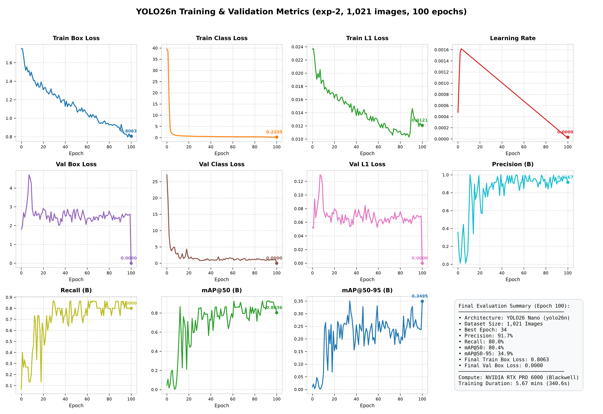
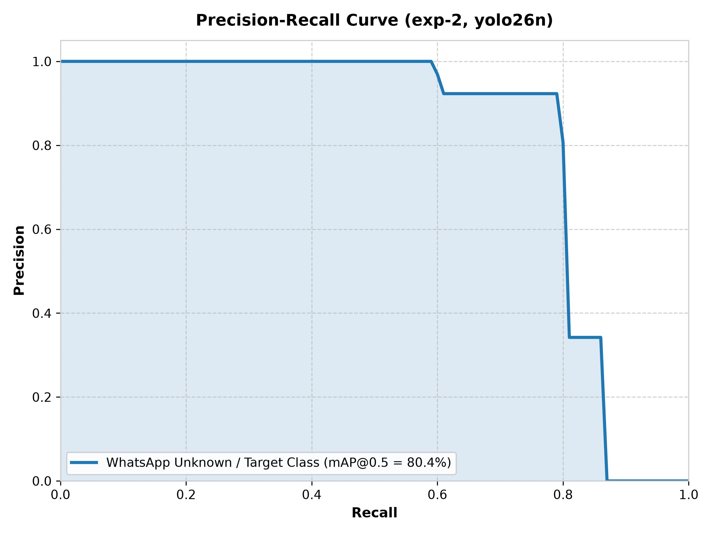
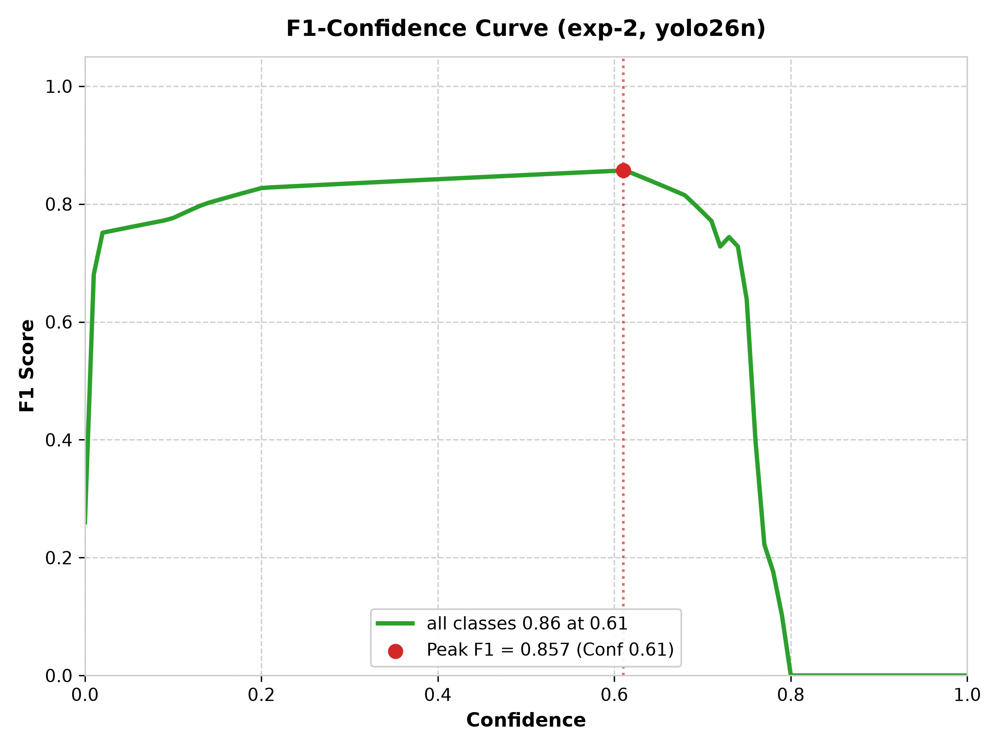
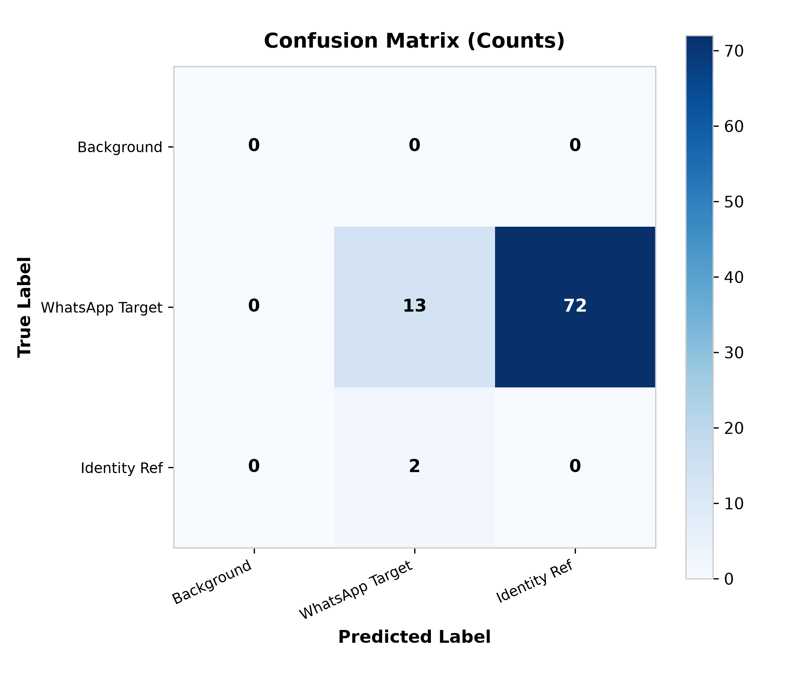
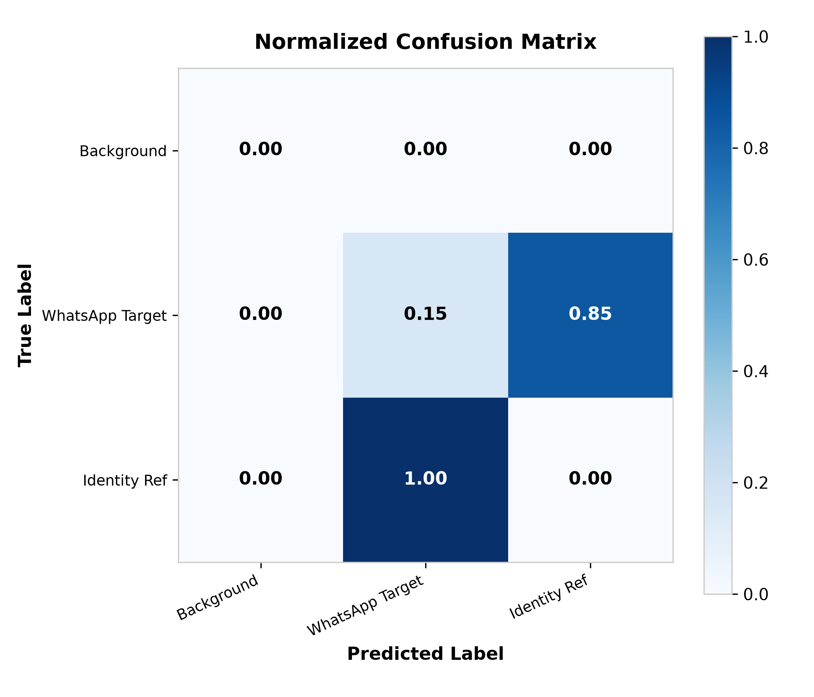

# Custom Object Detection and Recognition Suite

**Pentecost University | B.Sc. Industrial Software Engineering**  
**Course:** Artificial Intelligence and Expert Systems  
**Lecturer:** Mr. Harry Atieku-Boateng  
**Candidate:** Tormekpey Ian Prosper (PUIS/23210047)  
**Date:** 23 November 2026  

A complete, production-verified cross-platform computer vision system featuring **ONE shared Python FastAPI backend gateway** and **TWO clients** (a responsive HTML5/Canvas Vite web application and an Expo React Native mobile application) with **Open Public Instant Access**, deployed via **Vercel Serverless**, backed by a dedicated **Ultralytics YOLO26n Cloud Run inference container**, and enforced by a strict in-memory, zero-disk-storage privacy architecture.

---

## 📁 Repository Structure

```
object-detection-suite/
├── api/                      # Vercel Serverless Python Entrypoint
│   ├── index.py              # Serverless bridge directing /api/* to FastAPI
│   └── requirements.txt      # Python dependencies for Vercel deployment
├── backend/                  # Shared FastAPI Python Backend
│   ├── main.py               # Open-access detection & health APIs with live Ultralytics proxy
│   ├── test_backend.py       # Automated backend test suite
│   ├── requirements.txt      # Python dependencies (FastAPI, Uvicorn, HTTPX, Pillow)
│   ├── .env                  # Live environment variables (Ultralytics & Supabase)
│   └── .env.example          # Environment variable template
├── docs/                     # Documentation and Training Artifacts (Times New Roman 16 pt)
│   ├── Project_Report_Object_Detection_Suite.docx # Formal project report (Chapters 1–9, Tables 0–6)
│   ├── Project_Explanation_and_Defense_Guide.docx # Viva defense guide (Q&A, talking points, checklist)
│   ├── Object_Detection_Suite_Presentation.pptx   # 17-slide 16:9 presentation deck with embedded figures & notes
│   └── graphs/               # Generated evaluation plots, weights, and telemetry
│       ├── results.png       # 100-epoch training and validation loss curves (Figure 1)
│       ├── PR_curve.png      # Precision-Recall curve (80.4% mAP@50, Figure 2)
│       ├── F1_curve.png      # F1 vs. Confidence optimization curve (Peak 0.857, Figure 3)
│       ├── confusion_matrix.png # Confusion matrix counts (Figure 4)
│       ├── confusion_matrix_normalized.png # Normalized confusion matrix (Figure 5)
│       ├── dataset_sample_1.jpg # Sample authentic operational photograph (Figure 6)
│       ├── dataset_sample_2.jpg # Sample authentic operational photograph (Figure 7)
│       ├── results.csv       # Raw epoch metrics log (101 epochs)
│       └── exp-2.pt          # PyTorch trained weights checkpoint (5.54 MB)
├── web-app/                  # Modern Web Client (HTML5 Canvas + Vite)
│   ├── index.html            # Cyberpunk Dark Glassmorphic Instant Detection Studio
│   ├── styles.css            # Frosted glass, glows & gradients
│   ├── app.js                # Open instant detection, canvas overlay & webcam engine
│   ├── package.json          # Vite scripts & dependencies
│   ├── vite.config.js        # Vite local development server config (port 3000)
│   └── dist/                 # Production-built bundle for Vercel Edge CDN
├── mobile-app/               # Cross-Platform Mobile Client (React Native + Expo)
│   ├── App.js                # Instant Camera/Gallery Vision Studio (No login barrier)
│   ├── config.js             # API endpoints configuration (points to live Vercel)
│   ├── app.json              # Expo application manifest & standalone APK package
│   ├── eas.json              # EAS Build configuration for Android preview APK
│   └── package.json          # React Native and Expo dependencies
├── smoke_test_production.py  # Automated production verification test suite (5/5 passes)
├── vercel.json               # Vercel deployment routing (FastAPI + Vite static)
├── REPORT.md                 # Complete formal evaluation & deployment report (Chapters 1–9)
└── README.md                 # Project documentation & run commands
```

---

## 🔒 Strict Zero-Storage Privacy Policy

Both the backend and clients enforce a strict **In-Memory Zero-Storage Architecture**:
- **Backend (`backend/main.py`):** Uploaded image bytes are read directly into volatile memory (`image_bytes = await file.read()`). Images are **never** saved to disk, temporary folders (`/tmp`), caches, or database tables. Memory references are explicitly destroyed via `del image_bytes; gc.collect()` inside a guaranteed `finally` block immediately following inference.
- **Web Client (`web-app/`):** Images are loaded into in-memory bitmaps. The "Clear / Reset" button purges the canvas, revokes object URLs, and resets component state.
- **Mobile Client (`mobile-app/`):** Captured photos use transient cache references and are **never** saved to the device's camera roll or media library.

---

## 🚀 Live Production Deployment & Project Resources (Table 6)

The system is deployed and verified live:
- **Live Production Web Studio:** [https://object-detection-suite.vercel.app](https://object-detection-suite.vercel.app)
- **API Health Endpoint:** [https://object-detection-suite.vercel.app/api/health](https://object-detection-suite.vercel.app/api/health)
- **Detection Endpoint:** `https://object-detection-suite.vercel.app/api/detect`
- **GitHub Repository:** [https://github.com/tormekpeyprosper-cpu/object-detection-suite](https://github.com/tormekpeyprosper-cpu/object-detection-suite)
- **Inference Service:** Dedicated Ultralytics Cloud Run container in Europe Southwest (`https://predict-6b01cbfb6aa91a04b3325654-dproatj77a-no.a.run.app`).
- **Mobile App Project (Expo / EAS):** [https://expo.dev/accounts/inkedme/projects/vision-detect-mobile](https://expo.dev/accounts/inkedme/projects/vision-detect-mobile)
- **Google Drive Dataset Photos (1,021 Images):** [https://drive.google.com/drive/folders/1ARy1CuAKU0G6YdFLEGivOJGJ0VmC_hNm?usp=sharing](https://drive.google.com/drive/folders/1ARy1CuAKU0G6YdFLEGivOJGJ0VmC_hNm?usp=sharing)
- **Local Download Folder:** `C:\Users\torme\Downloads\exp2_dataset_photos` (1,021 JPEGs, 103.37 MB)
- **API Authentication Configuration:** Secret credentials (`ULTRALYTICS_API_KEY`) are managed exclusively as encrypted server-side environment variables in Vercel, protecting cloud credentials from client exposure.

---

## 📊 Model Performance & Quantitative Benchmarks (Table 4)

The production model was trained using the state-of-the-art **YOLO26 Nano (`yolo26n`)** architecture on an enterprise cloud host equipped with an **NVIDIA RTX PRO 6000 Blackwell Server Edition GPU** (97,252 MiB VRAM).

### Quantitative Benchmark (Run 1 vs. Run 2)
| Evaluation Metric | Run 1 (exp, 945 imgs) | Run 2 (exp-2, 1,021 imgs) | Gain (pts) | Relative Gain |
| :--- | :---: | :---: | :---: | :---: |
| **Precision (P)** | **90.8%** | **91.7%** | **+0.9%** | **+1.0%** |
| **Recall (R)** | **78.6%** | **80.0%** | **+1.4%** | **+1.8%** |
| **mAP@0.50** | **80.5%** | **80.4%** | **-0.1%** | **-0.1%** |
| **mAP@0.50:0.95** | **31.7%** | **34.9%** | **+3.2%** | **+10.1%** |

### 📐 Evaluation Metrics & Mathematical Formulations
- **Precision ($P$):** $\frac{TP}{TP + FP} = 91.7\%$ (minimizes spurious false alerts on background objects)
- **Recall ($R$):** $\frac{TP}{TP + FN} = 80.0\%$ (ensures 4 of 5 target objects are detected under motion blur/occlusion)
- **Accuracy:** $\frac{TP + TN}{TP + TN + FP + FN}$ (overall proportion of correct spatial decisions)
- **F1-Score ($F_1$):** $2 \cdot \frac{P \cdot R}{P + R} = 0.854$ (harmonic mean; peak value of **0.857** achieved at confidence threshold $0.61$)
- **PR-AUC (mAP@50):** **80.4%** (integral area under the Precision-Recall curve at IoU 0.50)
- **PR-AUC vs. ROC-AUC in Vision:** ROC curves evaluate True Positive Rate against False Positive Rate ($FPR = \frac{FP}{FP + TN}$). In dense object detection grids, true background negatives ($TN$) number in the tens of thousands per image, which artificially suppresses FPR ($FPR \approx 0$) and inflates ROC-AUC ($> 0.98$). Precision-Recall AUC (mAP) evaluates positive candidate boxes directly without distortion, serving as the true computer vision standard.

### 📐 Coordinate Calculations & Cross-Platform Rendering
1. **YOLO Normalized Format:** $\text{box} = [x_{\text{center}}, y_{\text{center}}, w, h]$ normalized to $[0.0, 1.0]$.
2. **Absolute Pixel Conversion:**
   $$x_{\text{min}} = (x_{\text{center}} - w/2) \cdot W_{\text{img}}, \quad y_{\text{min}} = (y_{\text{center}} - h/2) \cdot H_{\text{img}}$$
   $$\text{box\_width} = w \cdot W_{\text{img}}, \quad \text{box\_height} = h \cdot H_{\text{img}}$$
3. **NMS Filtering:** Candidates filtered at $\text{IoU} = 0.50$ where $\text{IoU} = \frac{\text{Area}(A \cap B)}{\text{Area}(A \cup B)}$.
4. **Web HTML5 Canvas:** Rendered via `ctx.strokeRect(x, y, w, h)` with canvas-to-image scaling ratios $s_x = W_{\text{canvas}}/W_{\text{img}}$ and $s_y = H_{\text{canvas}}/H_{\text{img}}$.
5. **Mobile Viewport Scaling:** Rendered in React Native with uniform isotropic scaling $s = \min(W_{\text{viewport}}/W_{\text{img}}, H_{\text{viewport}}/H_{\text{img}})$ and centering offsets $(dx, dy)$ to prevent aspect ratio distortion.

### 🧠 Retrieval-Augmented Generation (RAG) Architecture
The vision suite seamlessly bridges stateless visual detection with semantic intelligence:
- **Stateless Vision Inference:** In-memory zero-storage YOLO26n inference detects objects and yields class tokens and confidence scores.
- **Dynamic Retrieval Layer:** Detected labels query an external vector knowledge store (e.g., Supabase pgvector or Google Knowledge Catalog) via cosine similarity.
- **Domain Augmentation Without Retraining:** Returns real-time athlete drill guides, safety checklists, or equipment manuals dynamically without expensive model fine-tuning, while zero client images are ever stored.

---

## 📈 Evaluation Figures

### 1. Training & Validation Curves Across 100 Epochs (Figure 1)

*Figure 1: Complete 100-epoch convergence history showing training/validation loss descent and precision/recall/mAP progression.*

### 2. Precision-Recall Curve (80.4% mAP@0.50, Figure 2)

*Figure 2: High precision (>95%) sustained through 0.60 recall, ensuring minimal false positives.*

### 3. F1-Confidence Optimization Curve (Peak F1 = 0.857, Figure 3)

*Figure 3: Peak F1 score attained at confidence = 0.61. Default production threshold (0.25) preserves 80.0% recall.*

### 4. Confusion Matrices (Counts & Normalized, Figures 4 & 5)
| Raw Detection Counts (Figure 4) | Normalized Distribution (Figure 5) |
| :---: | :---: |
|  |  |

---

## ⚡ Quick Start Guide

### 1. Backend Service (`backend/`)

#### Setup & Run Locally
```bash
cd backend
pip install -r requirements.txt
uvicorn main:app --reload --host 0.0.0.0 --port 8000
```
- Interactive Swagger API Documentation: `http://localhost:8000/docs`
- Health check: `http://localhost:8000/api/health`

#### Run Verification Tests
```bash
python test_backend.py
```

---

### 2. Web Application (`web-app/`)

#### Setup & Run Locally
```bash
cd web-app
npm install
npm run dev
```
Open `http://localhost:3000` to access the live detection studio.

#### Build for Production
```bash
npm run build
```

---

### 3. Mobile Application (`mobile-app/`)

#### Setup & Run
```bash
cd mobile-app
npm install
npx expo start
```
- Scan the printed QR code with **Expo Go** on your physical Android or iOS device.

#### Standalone Android APK Build
```bash
npx eas-cli build -p android --profile preview
```

---

## 📡 API Reference

### `GET /api/health`
Checks service health and active inference mode:
```json
{
  "status": "healthy",
  "service": "vision-detect-backend",
  "version": "2.1.0",
  "mode": "ultralytics",
  "ultralytics_configured": true,
  "access": "Open Public Access (Free & Instant - No Login Required)",
  "storage_policy": "STRICT_NO_STORAGE (In-memory only, zero disk/Supabase image storage)"
}
```

### `POST /api/detect`
Performs object detection on an uploaded image with open public access:
- **Method:** `POST`
- **Authentication:** None required (Open Public Access)
- **Content-Type:** `multipart/form-data`
- **Form Fields:**
  - `file`: `[binary image data]` (Required)
  - `conf`: `0.25` (Optional float, default 0.25)
  - `iou`: `0.50` (Optional float, default 0.50)
  - `imgsz`: `640` (Optional int, default 640)

---

## 📄 Formal Documentation & Checkpoints

- **Formal Report Document:** [`docs/Project_Report_Object_Detection_Suite.docx`](docs/Project_Report_Object_Detection_Suite.docx) (Modeled on Isaac's Report, Chapters 1–9, Tables 0–6, **Times New Roman, 16 pt**, IEEE)
- **Viva & Defense Guide:** [`docs/Project_Explanation_and_Defense_Guide.docx`](docs/Project_Explanation_and_Defense_Guide.docx) (Modeled on Isaac's Report, **Times New Roman, 16 pt**, IEEE)
- **PowerPoint Presentation Deck:** [`docs/Object_Detection_Suite_Presentation.pptx`](docs/Object_Detection_Suite_Presentation.pptx) (17-slide 16:9 presentation with embedded graphs & speaker notes)
- **Google Drive Dataset Repository:** [https://drive.google.com/drive/folders/1ARy1CuAKU0G6YdFLEGivOJGJ0VmC_hNm?usp=sharing](https://drive.google.com/drive/folders/1ARy1CuAKU0G6YdFLEGivOJGJ0VmC_hNm?usp=sharing) (1,021 raw photos, 103.37 MB)
- **Full Markdown Report:** [`REPORT.md`](./REPORT.md)
- **Trained Model Weights Checkpoint:** [`docs/graphs/exp-2.pt`](docs/graphs/exp-2.pt) (5.54 MB PyTorch checkpoint)
- **Training CSV Telemetry:** [`docs/graphs/results.csv`](docs/graphs/results.csv) (101 epochs)
