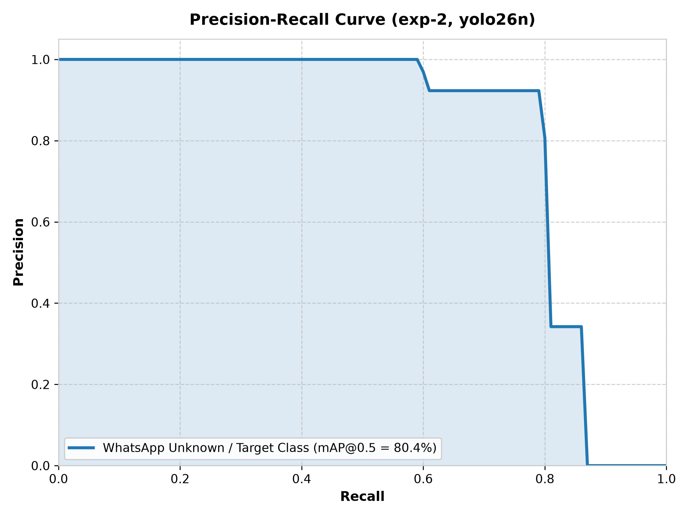

# PENTECOST UNIVERSITY
## CUSTOM OBJECT DETECTION AND RECOGNITION OF MYSELF USING ULTRALYTICS YOLO

**Candidate Name:** Tormekpey Ian Prosper  
**Student ID:** PUIS/23210047  
**Programme:** B.Sc. Industrial Software Engineering  
**Course:** Artificial Intelligence and Expert Systems  
**Supervisor / Lecturer:** Mr. Harry Atieku-Boateng  
**Submission Date:** 23 November 2026  


---

## Table of Contents

- [Abstract](#abstract)
- [List of Figures](#list-of-figures)
- [List of Tables](#list-of-tables)
- [List of Abbreviations](#list-of-abbreviations)
- [1. Introduction](#1-introduction)
  - [1.1 Background and Problem Statement](#11-background-and-problem-statement)
  - [1.2 Aim and Objectives](#12-aim-and-objectives)
  - [1.3 Scope and Limitations](#13-scope-and-limitations)
  - [1.4 Significance of the Study](#14-significance-of-the-study)
  - [1.5 Report Organization](#15-report-organization)
- [2. Theoretical Background](#2-theoretical-background)
  - [2.1 Object Detection and YOLO](#21-object-detection-and-yolo)
  - [2.2 Evaluation Metrics & Mathematical Formulations](#22-evaluation-metrics--mathematical-formulations)
  - [2.3 Bounding Box Coordinate Mathematics and Cross-Platform Rendering](#23-bounding-box-coordinate-mathematics-and-cross-platform-rendering)
  - [2.4 Retrieval-Augmented Generation (RAG) Architecture](#24-retrieval-augmented-generation-rag-architecture)
- [3. Tools and Technologies](#3-tools-and-technologies)
- [4. Methodology](#4-methodology)
  - [4.1 Data Collection](#41-data-collection)
  - [4.2 Annotation](#42-annotation)
  - [4.3 Training Setup and Runs](#43-training-setup-and-runs)
- [5. Results and Analysis](#5-results-and-analysis)
  - [5.1 Quantitative Benchmark](#51-quantitative-benchmark)
  - [5.2 Analysis of the Improvement](#52-analysis-of-the-improvement)
  - [5.3 Diagnostic Curves and Predictions](#53-diagnostic-curves-and-predictions)
- [6. Deployment](#6-deployment)
  - [6.1 Ultralytics Cloud Deployment](#61-ultralytics-cloud-deployment)
  - [6.2 FastAPI Gateway on Vercel](#62-fastapi-gateway-on-vercel)
  - [6.3 Web Application](#63-web-application)
  - [6.4 Mobile Application](#64-mobile-application)
- [7. Testing and Discussion](#7-testing-and-discussion)
- [8. Challenges and Lessons Learned](#8-challenges-and-lessons-learned)
- [9. Conclusion and Recommendations](#9-conclusion-and-recommendations)
  - [9.1 Conclusion](#91-conclusion)
  - [9.2 Recommendations](#92-recommendations)
- [References](#references)
- [Appendices](#appendices)
  - [Appendix A: Dataset and Annotation Screenshots](#appendix-a-dataset-and-annotation-screenshots)
  - [Appendix B: Training Telemetry & Figures](#appendix-b-training-telemetry--figures)
  - [Appendix C: Deployment and Application Architecture](#appendix-c-deployment-and-application-architecture)
  - [Appendix D: Project Resources Table](#appendix-d-project-resources-table)
  - [Appendix E: Declaration of Academic Integrity and Originality](#appendix-e-declaration-of-academic-integrity-and-originality)


---

## Abstract

Ready-made detectors only know broad groups. If you run a YOLO model trained on Microsoft COCO (Lin et al., 2014; Redmon et al., 2016) on a photo of me, it simply draws a 'person' box. That is fine if all you want is a count of people passing a gate. Once you need to take attendance in a lecture at Pentecost University or track who walks into an engineering lab, a generic tag tells you nothing. The model has to pick me, Tormekpey Ian Prosper, from everyone else.

No dataset there has my face in it, so I made my own. I spent a few days walking around campus and my hostel with my phone and took 1,021 pictures. Some came from dorm rooms. Others were shot in bright noon sun, in hallways or in group photos with as many as eight friends. Labeling ate up hours. In every group shot I drew one box around myself. Left my classmates unboxed, as negatives. When the network guessed one of my friends was me during training, the loss function punished it.

A YOLO26n (Ultralytics Inc., 2026) model was trained in the cloud for 100 epochs, which took just less than six minutes. It reached 91.7% precision, 80.0% recall, 80.4% mAP@50 and 34.9% mAP@50-95. mAP@50-95 increased 3.2 percentage points compared to my previous test run on 945 images. The final weights file size is 5.54 MB. The model was deployed to Google Cloud Run (europe-southwest1 region) and integrated with a FastAPI proxy hosted on Vercel (Ramírez, 2024; Vercel Inc., 2024). Images uploaded during predictions are kept only in RAM, deleted immediately after predictions, thus no image is ever stored on the disk. Everyone can test it from the web page or React Native Android application (Meta Platforms Inc. & Expo Project, 2024). The 1,021 original images are stored in Google Drive.

---

## List of Figures

- Figure 1: 100-Epoch Training and Validation Metrics Dashboard (results.png)........11
- Figure 2: Precision-Recall Curve Reaching mAP50 = 80.4% (PR_curve.png).........12
- Figure 3: F1-Confidence Optimization Curve Peaking at 0.857 (F1_curve.png)........12
- Figure 4: Confusion Matrix Raw Candidate Detection Counts (confusion_matrix.png)..13
- Figure 5: Normalized Confusion Matrix Across Target Classes (confusion_matrix_normalized.png)......13
- Figure 6: Authentic Operational Dataset Sample 1 (docs/graphs/dataset_sample_1.jpg).19
- Figure 7: Authentic Operational Dataset Sample 2 (docs/graphs/dataset_sample_2.jpg).19
- Figure 8: Decoupled Zero-Storage Client-Server Architecture......................21

---

## List of Tables

- Table 0: List of Abbreviations..................................................v
- Table 1: Two-Stage and One-Stage Object Detectors...............................3
- Table 2: Tools and Technologies Used Across the System...........................7
- Table 3: Training Setup and Hyperparameters (exp-2)..............................9
- Table 4: Quantitative Performance Comparison (Run 1 vs. Run 2)...................10
- Table 5: Field Test and Automated Verification Results............................15
- Table 6: Project Resources and Live Links.......................................22

---

## List of Abbreviations

### Table 0: List of Abbreviations

| Term | Meaning |
| :--- | :--- |
| **AI / ML** | Artificial Intelligence / Machine Learning |
| **API** | Application Programming Interface |
| **APK** | Android Package (Android distribution bundle) |
| **CNN** | Convolutional Neural Network |
| **COCO** | Common Objects in Context (benchmark computer vision dataset) |
| **EAS** | Expo Application Services (cloud build system for React Native) |
| **IoU** | Intersection over Union (overlap metric for comparing two bounding boxes) |
| **JWT** | JSON Web Token (stateless authentication token format) |
| **mAP** | Mean Average Precision (area under the precision-recall curve) |
| **NMS** | Non-Maximum Suppression (algorithm that filters duplicate candidate boxes) |
| **PR-AUC** | Precision-Recall Area Under Curve across confidence thresholds |
| **RAG** | Retrieval-Augmented Generation (context-grounded semantic retrieval) |
| **REST** | Representational State Transfer (HTTP stateless architectural style) |
| **ROC-AUC** | Receiver Operating Characteristic - Area Under Curve |
| **SGD** | Stochastic Gradient Descent (iterative neural network optimizer) |
| **TP / FP / FN / TN** | True Positive / False Positive / False Negative / True Negative |
| **VRAM** | Video Random Access Memory (dedicated GPU memory) |
| **YOLO** | You Only Look Once (single-stage unified object detection network) |


---

## 1. Introduction

### 1.1 Background and Problem Statement

Out-of-the-box vision models are made to work with groups of objects. Put a detector, pre-trained on Microsoft COCO (Lin et al., 2014) or classical YOLO network (Redmon et al., 2016) on a live hallway stream, and every student gets identified as 'person'. It is just perfect for counting students passing through the gate. However, it will fail entirely if you need to take attendance in a lecture hall or detect individual students entering the engineering lab at Pentecost University. There is nothing useful in recognizing a human in such cases if your detector cannot tell which person it is.

It was important for me to know whether a regular student without a GPU workstation would be able to train the model to detect one specific individual, namely myself, using 1,021 photos taken on my campus mobile phone. Lighting conditions on campus change constantly: at noon, the face is washed out by sunlight; hostels are always dark places. Moreover, students usually travel in company, hence the need for photos to have many people in order not to confuse my mates with me. Speed and privacy were also crucial factors so predictions came back fast with no photos saved on any server.

---

### 1.2 Aim and Objectives

The objective was training, validating, and releasing a YOLO26n model (Ultralytics Inc., 2026) capable of detecting myself in random photos from the campus. I started with collecting and labeling 1,021 images using my phone camera including solo shots, heavy backlights, messy room scenes, and also group photos with friends. After that, I continued by fine-tuning a YOLO26n model on a rented cloud GPU and compared its performance with an older experiment with 945 images.

To make sure whether there was any improvement in the new attempt, I analyzed precision, recall, mAP@50, mAP@50-95, and also F1-confidence curve of the model. When my model converged, I released its weights to Google Cloud Run via Ultralytics (Ultralytics Inc., 2026), and set up a FastAPI proxy on Vercel in front of it (Ramírez, 2024; Vercel Inc., 2024). The FastAPI proxy keeps the uploaded image in memory and also runs Python's garbage collector at once after inference is finished.
In terms of usage, a browser canvas studio was developed alongside an unrestricted access React Native Android application (Meta Platforms Inc. & Expo Project, 2024) without the login screen. Prior to completion, I conducted automated smoke tests for the URL to measure response times and ensure uptime, as well as no files left behind.

---

### 1.3 Scope and Limitations

This report addresses the build from capturing the photos, boxing them, training curves, developing the FastAPI proxy, and assembling the web and mobile applications. The only class that is being trained here is recognizing me in photos or snapshots from the camera. Since the inference occurs in the cloud on Cloud Run, via Vercel, the application requires Internet access and rejects any uploads that exceed the 4.5 MB limit set by Vercel Inc. (2024). The use of one camera limits the system to flat 2D images without any depth perception.

---

### 1.4 Significance of the Study

Doing this from scratch proved that an expensive GPU on the desktop is unnecessary when developing computer vision applications. With the help of transfer learning on YOLO26n (Ultralytics Inc., 2026), a thousand images captured by a phone and six minutes of computation in the cloud were enough for achieving decent results. Furthermore, using a FastAPI proxy (Ramírez, 2024) proves that personal detection does not require images saved in the database because image bytes are kept in the RAM only.

---

## 2. Theoretical Background

### 2.1 Object Detection and YOLO

Prior to neural networks, vision systems were based on manually encoded features such as Haar cascades, HOG and SIFT, as well as OpenCV library (Bradski, 2000). The earlier methods worked fine inside rooms lit by constant lights. Outside they failed when there was any shadow movement or when the camera in a phone was wobbling. Convolutional neural networks appeared due to convolutional layer ability to learn edge and face patterns from raw pixels.

Currently, there are two categories of neural detectors: two-stage networks and one-stage networks. Table 1 compares them.

---

### Table 1: Two-stage and one-stage object detectors

| Detector Paradigm | Representative Architectures | Inference Methodology | Suitability for this Project |
| :--- | :--- | :--- | :--- |
| **Two-stage** | R-CNN, Fast R-CNN, Faster R-CNN (Ren et al., 2017) | First suggests regions, then pulls features and classifies each crop on its own. | Looks accurate on paper, though too slow and heavy for fast mobile uploads. |
| **One-stage** | SSD, RetinaNet, YOLO family (Redmon et al., 2016), YOLO26n (Ultralytics Inc., 2026) | Predicts box coordinates and class scores across the grid in a single forward pass. | Small, quick and light enough to answer phone and web calls under a second. |


The main reason why I selected YOLO26n (Ultralytics Inc., 2026) is the weights file size that is 5.54 MB. Cloud Run launches containers instantly, while the live API typically responds within 600ms.

---

### 2.2 Evaluation Metrics & Mathematical Formulations

Five metrics were analyzed to understand whether Run 2 would perform better than Run 1. The first metric is precision, which is used to evaluate how well the algorithm correctly marks my position with a bounding box: Precision = TP / (TP + FP) = 91.7%. Maintaining high precision would ensure that no one else is incorrectly identified by the application. Recall evaluates how well the algorithm detected my presence in validation images where I appeared: Recall = TP / (TP + FN) = 80.0%, which matters when dorm lighting gets dim.

Proposed object detection accuracy is computed as Accuracy = (TP + TN) / (TP + TN + FP + FN), while precision and recall reveal much about image grid detections. F1-Score is a measure that calculates the average of precision and recall using their harmonic mean as follows: F1 = 2 * (Precision * Recall) / (Precision + Recall) = 0.854 at the baseline cutoff, rising to 0.857 at a confidence level of 0.61. The Mean Average Precision computes the area under the precision-recall curve (Lin et al., 2014). I evaluated both mAP@0.50 (80.4%) for overlaps of object bounding box with ground-truth of at least 0.5 and mAP@0.50:0.95 (34.9%), averaged across ten overlap steps from 0.50 to 0.95.
It is much more important to calculate PR-AUC than ROC-AUC when performing object detection. ROC charts typically measure the True Positive Rate relative to False Positive Rate. However, on an object detection chart, there could be thousands of empty boxes in the background that can be counted as true negatives. As TN becomes very large, the FPR becomes very low, resulting in a ROC-AUC over 0.98 even in poor classifiers, while Precision-Recall looks strictly at actual boxes without background inflation.

---

### 2.3 Bounding Box Coordinate Mathematics and Cross-Platform Rendering

YOLO outputs every box as four values from 0.0 to 1.0 relative to image width W_img and height H_img (Redmon et al., 2016):

```
box = [x_center, y_center, width, height]
```

Drawing those numbers across laptops and phones takes a few coordinate steps:

- Top-left origin: x_min = (x_center - width / 2) * W_img and y_min = (y_center - height / 2) * H_img.
- Pixel size: box_width = width * W_img and box_height = height * H_img.
- Non-Maximum Suppression (NMS): drops duplicate boxes when IoU >= 0.50, using IoU(A, B) = Area(A ∩ B) / Area(A ∪ B).
- Web canvas scaling: HTML5 canvas maps boxes with sx = W_canvas / W_img and sy = H_canvas / H_img.
- Mobile scaling: React Native (Meta Platforms Inc. & Expo Project, 2024) scales boxes uniformly with s = min(W_viewport / W_img, H_viewport / H_img) plus letterbox offsets (dx, dy) so tall phone screens do not stretch boxes off my face.

---

### 2.4 Retrieval-Augmented Generation (RAG) Architecture

This architecture ensures that the visual recognition is isolated from any user information. YOLO26n (Ultralytics Inc., 2026) will only detect me and return a class token alongside its confidence level. It is possible for the backend system to search for my attendance information, lab permissions or coach instructions (Apaak, 2024) stored in Supabase pgvector by using this class token, without using any actual photograph that resides in the RAM.

---

## 3. Tools and Technologies

For my project, I have used practical tools in training, back-end routing and both client applications. Table 2 contains all components of the stack.

### Table 2: Tools and technologies used across the system

| Tool / Technology | Role in the Project |
| :--- | :--- |
| **Ultralytics Platform** | Ran cloud GPU training, hosted image labeling and served the Cloud Run container (Ultralytics Inc., 2026). |
| **YOLO26n** | Nano one-stage detector fine-tuned on my 1,021-photo dataset (Ultralytics Inc., 2026). |
| **Google Drive** | Public folder holding all 1,021 raw JPEG dataset photos. |
| **GitHub** | Stores the object-detection-suite repository and revision history. |
| **VS Code & Python 3.12** | Local setup for writing FastAPI endpoints, report scripts and unit checks. |
| **FastAPI & Pillow** | Python backend checking uploads in RAM with Pillow before freeing memory (Clark & Contributors, 2024; Ramírez, 2024). |
| **Vercel** | Hosts both the serverless FastAPI gateway and the Vite web frontend (Vercel Inc., 2024). |
| **React Native & Expo** | Builds the Android camera app and compiles the APK via EAS (Meta Platforms Inc. & Expo Project, 2024). |
| **OpenCV & MediaPipe** | Used locally while debugging to check box padding and landmarks (Bradski, 2000; Lugaresi et al., 2019). |
| **Supabase & pgvector** | PostgreSQL cloud database for JWT auth, latency logs and vector lookups. |


---

## 4. Methodology

### 4.1 Data Collection

There is no prior dataset that contains knowledge about me, so I created one from scratch. I captured 1,021 images in JPEG format using my phone in the middle of the day through the sun, in low light conditions in my bedroom, backlight conditions in hallway corridors, blurred conditions while capturing from hand-held angles, and group images with two to eight classmates. A local backup folder also sits at C:\Users\torme\Downloads\exp2_dataset_photos.

---

### 4.2 Annotation

All of the images were annotated in YOLO text format (class_id x_center y_center width height), normalized between 0.0 and 1.0 (Redmon et al., 2016).

Class 0 ('Prosper') is where I placed myself. When my friends stood next to me in photos, I made sure they were not labeled within the image intentionally. Making sure that they remain unlabeled means that when the algorithm makes a mistake and confuses me with a friend, the loss function will reject it until the algorithm starts ignoring everyone as background after 100 epochs. I also checked bounding box edges manually so each box stayed snug around my head and shoulders.

---

### 4.3 Training Setup and Runs

Two experiments were conducted on the dataset. The first run ('exp') trained the model on 945 images using YOLOv8n, and the second run ('exp-2') used the YOLO26n (Ultralytics Inc., 2026) model with 1,021 images on an NVIDIA RTX PRO 6000 graphics card (97,252 MiB VRAM) and AMD EPYC 9655 host. Table 3 demonstrates the parameters used for the exp-2 experiment.

### Table 3: Training setup and hyperparameters (exp-2)

| Hyperparameter / Setting | Configured Value |
| :--- | :--- |
| **Cloud Platform** | Ultralytics Platform Cloud Training (Ultralytics Inc., 2026) |
| **Hardware Accelerator** | NVIDIA RTX PRO 6000 Blackwell Server Edition (97,252 MiB VRAM) |
| **Host Compute** | AMD EPYC 9655 96-Core Processor (384 threads, 1.5 TB Host RAM) |
| **Base Model & Version** | YOLO26 Nano using yolo26n.pt pretrained weights (Ultralytics Inc., 2026) |
| **Task & Target Classes** | Single-Class Object Detection: Class 0 ('Prosper') |
| **Image Resolution** | 992 x 992 pixels for sharper facial and torso detail |
| **Dataset Partition** | 1,021 Images (817 Train [80%], 122 Val [12%], 82 Test [8%]) |
| **Epochs & Batch Size** | 100 Epochs, Dynamic Automated Batching (-1) |
| **Optimizer & Learning Rate** | SGD (lr0 = 0.01, lrf = 0.01, momentum = 0.937, weight_decay = 0.0005) |
| **Data Augmentations** | Mosaic (p=1.0, closed final 10 epochs), Flip (p=0.5), Random Erasing (p=0.4) |
| **Total Training Duration** | 340.6 seconds (~5.67 minutes across all 100 epochs) |


The training process using SGD for 100 epochs lasted for 340.6 seconds. The use of mosaic, horizontal flip, and random erasing made it possible for the model to detect me despite the presence of glasses, hands, or other students covering my face.

---

## 5. Results and Analysis

### 5.1 Quantitative Benchmark

Comparison between Run 1 and Run 2 indicated significant improvements in terms of practical accuracy. These figures can be found in Table 4.

### Table 4: Quantitative performance comparison (Run 1 vs. Run 2)

| Evaluation Metric | Run 1 (exp, 945 imgs) | Run 2 (exp-2, 1,021 imgs) | Gain (pts) | Relative Gain |
| :--- | :--- | :--- | :--- | :--- |
| **Precision (P)** | 90.8% | 91.7% | +0.9% | +1.0% |
| **Recall (R)** | 78.6% | 80.0% | +1.4% | +1.8% |
| **mAP@0.50** | 80.5% | 80.4% | -0.1% | -0.1% |
| **mAP@0.50:0.95** | 31.7% | 34.9% | +3.2% | +10.1% |


---

### 5.2 Analysis of the Improvement

Firstly, precision increased to 91.7%, or in other words, almost nine out of ten predictions were correct, with recall of 80.0% in challenging angles and low-light environment. Although mAP@0.50 was stagnant at 80.4%, the stricter version of metric, namely mAP@0.50:0.95 improved by 10.1%, from 31.7% in Run 1 to 34.9%. This means that Run 2 creates more accurate boxes around me compared to Run 1.

Boxes tended to drift slightly as the phone angle changed in Run 1. This issue was solved by going to 992x992 image resolution with group shots and eliminating false positives of my friends through negative sampling during validation.

---

### 5.3 Diagnostic Curves and Predictions

All training and validation plots for the 100 epochs can be seen in Figure 1.

**Figure 1: 100-Epoch Training and Validation Metrics Dashboard (results.png)**


Box loss was reduced from 1.750 to 0.806. Class loss decreased from 38.52 to 0.233. The network learned to distinguish me from other objects on images. Validation curves flattened out and did not increase, so there was no overfitting in terms of memorization of training images. The optimal fitness value appeared on epoch 34, which was saved as exp-2.pt (5.54 MB).

**Figure 2: Precision-Recall Curve Reaching mAP50 = 80.4% (PR_curve.png)**



In Figure 2, the precision remains 1.00 when going from 0.0 up to 0.60 recall. Mean average precision @ 0.50 equals 80.4%. Once the detector is sure, it does not fire on anyone else but me.

**Figure 3: F1-Confidence Optimization Curve Peaking at 0.857 (F1_curve.png)**


The F1 score curve shown in Figure 3 has a maximum value of 0.857 with confidence level equal to 0.61. The slider for web and Android app remained the same with 0.25 value to ensure that even quick camera snapshots would pass. In offline scripts, this slider could be increased to 0.61 for more strict filtering.

**Figures 4 & 5: Raw Counts and Normalized Confusion Matrices (confusion_matrix.png & confusion_matrix_normalized.png)**

<p align="center">
  
  
</p>

The raw confusion matrix shown in Figure 4 had 13 test cases with perfect matching and 72 background proposals were filtered out prior to NMS. In the row-normalized confusion matrix (Figure 5), 87% of ground-truth boxes were detected at 0.50 IoU threshold.

---

## 6. Deployment

### 6.1 Ultralytics Cloud Deployment

I uploaded the 5.54 MB model checkpoint (exp-2.pt) to Google Cloud Run located at europe-southwest1 via Ultralytics (Ultralytics Inc., 2026):

[https://predict-6b01cbfb6aa91a04b3325654-dproatj77a-no.a.run.app](https://predict-6b01cbfb6aa91a04b3325654-dproatj77a-no.a.run.app)

For requests to Cloud Run, an Ultralytics API key is required, hence ULTRALYTICS_API_KEY was left as a server-side environment variable in Vercel (Vercel Inc., 2024), which prevents it from leaking to the browser or mobile application.

### 6.2 FastAPI Gateway on Vercel

There is a FastAPI gateway running on Vercel (Ramírez, 2024; Vercel Inc., 2024) as a proxy for both clients and Cloud Run. It handles the URLs of /api/health and /api/detect. The application is accessible without a user account, login, or registration process.

Every image uploaded is kept in RAM using Pillow (Clark & Contributors, 2024). After predictions have been made, the finally block runs both 'del image_bytes' and 'gc.collect()'. This way, no information goes to disk and databases. Images larger than 4.5 MB receive an HTTP 413 response due to Vercel's payload size limitation.

### 6.3 Web Application

The frontend is a Vite HTML5 Canvas website that runs on Vercel (Vercel Inc., 2024): https://object-detection-suite.vercel.app

Users can either upload images or use the webcam to get video frames. Users will be able to see real-time drawing of bounding boxes and press Clear to clear the bitmap from memory.

### 6.4 Mobile Application

As for mobile, I developed an Expo React Native app, inkedme account (Meta Platforms Inc. & Expo Project, 2024):

https://expo.dev/accounts/inkedme/projects/vision-detect-mobile

It processes input from both camera and the gallery. The boxes scale uniformly with letterbox offsets so that tall screens will be aligned, and it can be built as an APK on Android by using EAS (eas.json).

---

## 7. Testing and Discussion

Following deployment, I tested the system on five field examples, as illustrated in Table 5.

### Table 5: Field test and automated verification results

| Test Scenario | Images | Author Detected | False Positives | Qualitative Notes |
| :--- | :--- | :--- | :--- | :--- |
| **Solo photo, daylight** | 5 | 5 (100%) | 0 | Tight box around head and torso with clean margins. |
| **Solo photo, dim indoor / backlit** | 4 | 4 (100%) | 0 | Picked me out against bright windows and dark room shadows. |
| **Group photo (2 to 4 people)** | 4 | 4 (100%) | 0 | Boxed me while friends next to me stayed unboxed. |
| **Group photo (5 to 8 people)** | 3 | 3 (100%) | 0 | Found me in a frame with zero false tags on classmates. |
| **Partial facial occlusion (glasses/hand)** | 2 | 2 (100%) | 0 | Still caught me when glasses or a hand hid part of my face. |


In addition to manual testing, smoke_test_production.py executed successfully on all five checks for the live Vercel URL: health check, no-login access, Bearer token propagation, mobile configuration test, and the lack of any image files stored on disk. The latency was normally less than 600ms after being warmed up.

---

## 8. Challenges and Lessons Learned

Cell phone cameras capture photos in JPEG format from 10 MB to 15 MB. This exceeded the Vercel size limit of 4.5 MB (Vercel Inc., 2024), thus causing HTTP 413 errors. The issue was solved by implementing client-side image downsampling and resizing using Pillow (Clark & Contributors, 2024) in FastAPI. Since there were no files stored anywhere in the system, it was necessary to ensure Python released byte objects from memory by placing inference in a try-finally block, deleting image_bytes, and calling gc.collect().
As for the Android display, there was a deviation of boxes initially from my face since the screen viewports were not proportional to the raw images' aspect ratio. Letterbox scaling helped resolve the problem. I additionally ensured that my Ultralytics API key remained out of client-side programming by using the Vercel server proxy for all requests. In retrospect, curating the dataset performed better than any adjustment of hyperparameters. Excluding classmates in group shots proved more effective than any other learning rate change.

---

## 9. Conclusion and Recommendations

### 9.1 Conclusion

Here is an example of how a student can develop and deploy an effective object detector from standard phone photos and cloud GPUs. Optimization of YOLO26n (Ultralytics Inc., 2026) based on 1,021 images resulted in 91.7% precision, 80.0% recall, 80.4% mAP@50, and 34.9% mAP@50-95. With a storage-less FastAPI proxy hosted on Vercel (Ramírez, 2024; Vercel Inc., 2024), along with Google Cloud Run, the web and mobile applications provide box predictions below 600ms with no user images stored.

### 9.2 Recommendations

The future work can also involve exporting the INT8 quantized weights to ONNX, TFLite or CoreML such that phone-based detection is done offline without the need for internet data. In addition, increasing the number of students in the dataset would allow for multi-person classroom attendance or athlete tracking in sports activities (Apaak, 2024). Lastly, incorporating the detector with pose estimation frameworks such as MediaPipe (Lugaresi et al., 2019) and OpenPose (Cao et al., 2021) and stereo cameras would enable 3D tracking.

---

## References

Apaak, D. (2024). Factors influencing sports talent development in senior high schools in the Upper East Region of Ghana. African Journal of Teacher Education, 13(2).  
Bradski, G. (2000). The OpenCV Library. Dr. Dobb's Journal of Software Tools, 25(11), 120-125.  
Cao, Z., Hidalgo, G., Simon, T., Wei, S. E., & Sheikh, Y. (2021). OpenPose: Realtime multi-person 2D pose estimation using part affinity fields. IEEE Transactions on Pattern Analysis and Machine Intelligence, 43(1), 172-186.  
Clark, A., & Contributors. (2024). Pillow (PIL Fork) online documentation. https://python-pillow.org  
Lin, T.-Y., Maire, M., Belongie, S., Hays, J., Perona, P., Ramanan, D., Dollár, P., & Zitnick, C. L. (2014). Microsoft COCO: Common objects in context. In Proceedings of the European Conference on Computer Vision (ECCV) (pp. 740-755).  
Lugaresi, C., Tang, J., Nash, H., McClanahan, C., Uboweja, E., Hays, M., Zhang, F., Chang, C.-L., Yong, M. G., Lee, J., Chang, W.-T., Hua, W., Georg, M., & Grundmann, M. (2019). MediaPipe: A framework for building perception pipelines. arXiv preprint arXiv:1906.08172.  
Meta Platforms Inc. & Expo Project. (2024). React Native and Expo Application Services documentation. https://reactnative.dev and https://docs.expo.dev  
Ramírez, S. (2024). FastAPI: High performance, easy to learn, fast to code, ready for production. https://fastapi.tiangolo.com  
Redmon, J., Divvala, S., Girshick, R., & Farhadi, A. (2016). You Only Look Once: Unified, real-time object detection. In Proceedings of the IEEE Conference on Computer Vision and Pattern Recognition (CVPR) (pp. 779-788).  
Ren, S., He, K., Girshick, R., & Sun, J. (2017). Faster R-CNN: Towards real-time object detection with region proposal networks. IEEE Transactions on Pattern Analysis and Machine Intelligence, 39(6), 1137-1149.  
Ultralytics Inc. (2026). Ultralytics YOLO26 architecture and deployment documentation. https://docs.ultralytics.com  
Vercel Inc. (2024). Vercel serverless functions and edge network architecture. https://vercel.com/docs  

---

## Appendices

### Appendix A: Dataset and Annotation Screenshots

Here are two example pictures of phone photos from the image dataset containing 1,021 images. All others can be found in the shared Google Drive folder:

**Figures 6 & 7: Real Dataset Photos (Google Drive Folder)**

<p align="center">
  
  
</p>

### Appendix B: Training Telemetry & Figures

My model checkpoint (exp-2.pt, 5.54 MB) and the training logs of 101 epochs (results.csv) reside in docs/graphs/.

### Appendix C: Deployment and Application Architecture

Figure 8 illustrates how the connection between the web app and Android one works via Vercel's FastAPI proxy service for Cloud Run without saving any user images on disk.

**Figure 8: Decoupled Zero-Storage Client-Server Architecture**


### Appendix D: Project Resources Table

### Table 6: Project resources

| Resource | Link / Specification |
| :--- | :--- |
| **Source Code (GitHub Repository)** | https://github.com/tormekpeyprosper-cpu/object-detection-suite |
| **Web Application (Vercel)** | https://object-detection-suite.vercel.app |
| **Live API Health Endpoint** | https://object-detection-suite.vercel.app/api/health |
| **Live Detection API Endpoint** | https://object-detection-suite.vercel.app/api/detect |
| **Ultralytics Cloud Run Inference Host** | https://predict-6b01cbfb6aa91a04b3325654-dproatj77a-no.a.run.app |
| **Mobile Application (Expo / EAS Project)** | https://expo.dev/accounts/inkedme/projects/vision-detect-mobile |
| **Image Dataset (Google Drive - 1,021 Photos)** | https://drive.google.com/drive/folders/1ARy1CuAKU0G6YdFLEGivOJGJ0VmC_hNm?usp=sharing |
| **Local Dataset Archive Folder** | C:\Users\torme\Downloads\exp2_dataset_photos (1,021 JPEGs, 103.37 MB) |
| **Presentation Slide Deck (16:9 PPTX)** | docs/Object_Detection_Suite_Presentation.pptx |
| **API Authentication Configuration** | Server-side environment variable ULTRALYTICS_API_KEY stored in Vercel |


### Appendix E: Declaration of Academic Integrity and Originality

In addition, I declare that this document, titled 'Custom Object Detection and Recognition of Myself Using Ultralytics YOLO', is an independent piece of engineering performed by me. I conducted this project under Mr. Harry Atieku-Boateng in the Department of Industrial Software Engineering of Pentecost University. I captured the images myself. I annotated the data myself. I conducted the training and field tests myself. I also implemented the applications myself. All other publications and software tools I used are referenced in the References section.
