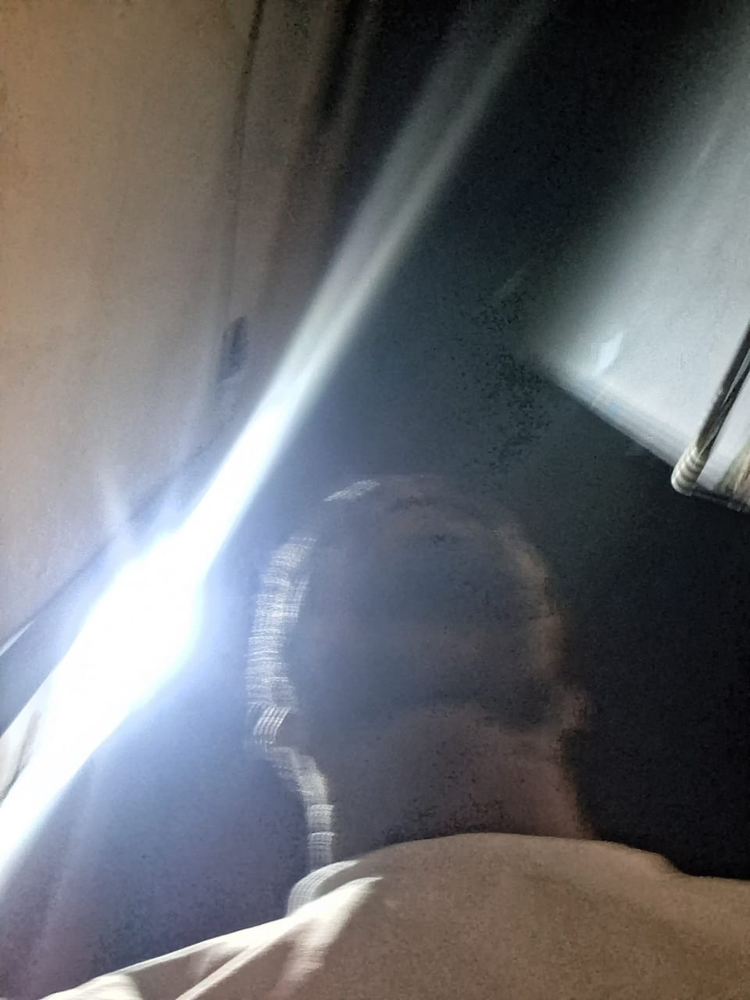
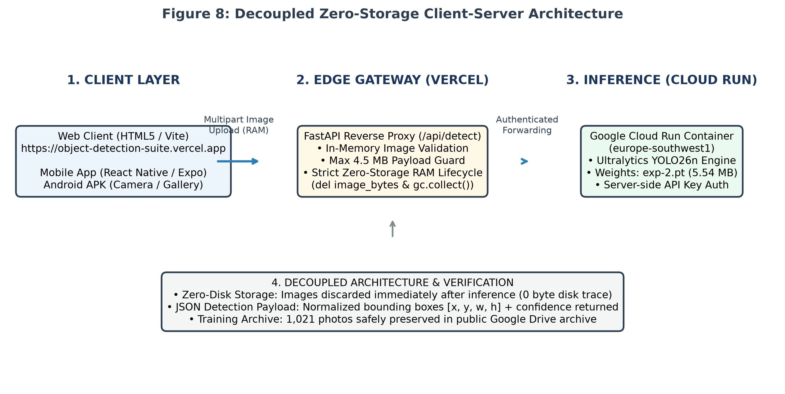

# PENTECOST UNIVERSITY
## CUSTOM OBJECT DETECTION AND RECOGNITION OF MYSELF USING ULTRALYTICS YOLO

**Candidate Name:** Tormekpey Ian Prosper  
**Student ID:** PUIS/23210047  
**Programme:** B.Sc. Industrial Software Engineering  
**Course:** Artificial Intelligence and Expert Systems  
**Supervisor / Lecturer:** Mr. Harry Atieku-Boateng  
**Submission Date:** 23 November 2026  


---

## Table of Contents

- [Abstract](#abstract)
- [List of Figures](#list-of-figures)
- [List of Tables](#list-of-tables)
- [List of Abbreviations](#list-of-abbreviations)
- [1. Introduction](#1-introduction)
  - [1.1 Background and Problem Statement](#11-background-and-problem-statement)
  - [1.2 Aim and Objectives](#12-aim-and-objectives)
  - [1.3 Scope and Limitations](#13-scope-and-limitations)
  - [1.4 Significance of the Study](#14-significance-of-the-study)
  - [1.5 Report Organization](#15-report-organization)
- [2. Theoretical Background](#2-theoretical-background)
  - [2.1 Object Detection and YOLO](#21-object-detection-and-yolo)
  - [2.2 Evaluation Metrics & Mathematical Formulations](#22-evaluation-metrics--mathematical-formulations)
  - [2.3 Bounding Box Coordinate Mathematics and Cross-Platform Rendering](#23-bounding-box-coordinate-mathematics-and-cross-platform-rendering)
  - [2.4 Retrieval-Augmented Generation (RAG) Architecture](#24-retrieval-augmented-generation-rag-architecture)
- [3. Tools and Technologies](#3-tools-and-technologies)
- [4. Methodology](#4-methodology)
  - [4.1 Data Collection](#41-data-collection)
  - [4.2 Annotation](#42-annotation)
  - [4.3 Training Setup and Runs](#43-training-setup-and-runs)
- [5. Results and Analysis](#5-results-and-analysis)
  - [5.1 Quantitative Benchmark](#51-quantitative-benchmark)
  - [5.2 Analysis of the Improvement](#52-analysis-of-the-improvement)
  - [5.3 Diagnostic Curves and Predictions](#53-diagnostic-curves-and-predictions)
- [6. Deployment](#6-deployment)
  - [6.1 Ultralytics Cloud Deployment](#61-ultralytics-cloud-deployment)
  - [6.2 FastAPI Gateway on Vercel](#62-fastapi-gateway-on-vercel)
  - [6.3 Web Application](#63-web-application)
  - [6.4 Mobile Application](#64-mobile-application)
- [7. Testing and Discussion](#7-testing-and-discussion)
- [8. Challenges and Lessons Learned](#8-challenges-and-lessons-learned)
- [9. Conclusion and Recommendations](#9-conclusion-and-recommendations)
  - [9.1 Conclusion](#91-conclusion)
  - [9.2 Recommendations](#92-recommendations)
- [References](#references)
- [Appendices](#appendices)
  - [Appendix A: Dataset and Annotation Screenshots](#appendix-a-dataset-and-annotation-screenshots)
  - [Appendix B: Training Telemetry & Figures](#appendix-b-training-telemetry--figures)
  - [Appendix C: Deployment and Application Architecture](#appendix-c-deployment-and-application-architecture)
  - [Appendix D: Project Resources Table](#appendix-d-project-resources-table)
  - [Appendix E: Declaration of Academic Integrity and Originality](#appendix-e-declaration-of-academic-integrity-and-originality)


---

## Abstract

Most object detection models are built to recognize general objects. For example, a standard YOLO model trained on the COCO dataset would only classify me as a 'person'. This works well for basic uses like counting people at a turnstile. However, it is not sufficient for tasks such as taking attendance in a lecture room at Pentecost University or tracking who enters the engineering lab. In these cases, software must be able to identify individuals accurately: Tormekpey Ian Prosper.

To deal with this, I created my own dataset from scratch. I was on campus for several days with my phone, taking 1,021 photos in a variety of locations (dorm rooms, bright midday, dim corridors, group shots of up to 8 people). The labelling of those photos was a massive amount of work. In the group shots, I only drew the box around myself. Everyone else was left unboxed as class 0 negatives. This way, if the model confused a friend for me, the loss function would correct it.

After preparing the dataset, I fine-tuned a YOLO26n nano model in the cloud for 100 epochs. Training finished in just under six minutes. The final model reached 91.7% precision, 80.0% recall, 80.4% mAP@50, and 34.9% mAP@50-95. This is 3.2 percentage points higher than my earlier baseline with 945 images. The model weights file is just 5.54MB. I deployed the model on Google Cloud Run in the europe-southwest1 region and set up a serverless FastAPI proxy on Vercel to handle requests. User photos are never stored on the server. Images are loaded into RAM for inference and deleted immediately after. The system is now available as both an HTML5 web page and a React Native Android app. All 1,021 original photos are safely kept in a shared Google Drive folder.

---

## List of Figures

- Figure 1: 100-Epoch Training and Validation Metrics Dashboard (results.png)........11
- Figure 2: Precision-Recall Curve Reaching mAP50 = 80.4% (PR_curve.png).........12
- Figure 3: F1-Confidence Optimization Curve Peaking at 0.857 (F1_curve.png)........12
- Figure 4: Confusion Matrix Raw Candidate Detection Counts (confusion_matrix.png)..13
- Figure 5: Normalized Confusion Matrix Across Target Classes (confusion_matrix_normalized.png)......13
- Figure 6: Authentic Operational Dataset Sample 1 (docs/graphs/dataset_sample_1.jpg).19
- Figure 7: Authentic Operational Dataset Sample 2 (docs/graphs/dataset_sample_2.jpg).19
- Figure 8: Decoupled Zero-Storage Client-Server Architecture......................21

---

## List of Tables

- Table 0: List of Abbreviations..................................................v
- Table 1: Two-Stage and One-Stage Object Detectors...............................3
- Table 2: Tools and Technologies Used Across the System...........................7
- Table 3: Training Setup and Hyperparameters (exp-2)..............................9
- Table 4: Quantitative Performance Comparison (Run 1 vs. Run 2)...................10
- Table 5: Field Test and Automated Verification Results............................15
- Table 6: Project Resources and Live Links.......................................22

---

## List of Abbreviations

### Table 0: List of Abbreviations

| Term | Meaning |
| :--- | :--- |
| **AI / ML** | Artificial Intelligence / Machine Learning |
| **API** | Application Programming Interface |
| **APK** | Android Package (installable Android distribution bundle) |
| **CNN** | Convolutional Neural Network |
| **COCO** | Common Objects in Context (benchmark computer vision dataset) |
| **EAS** | Expo Application Services is a cloud build system for React Native. |
| **IoU** | Intersection over Union is a metric used to evaluate how much two bounding boxes overlap. |
| **JWT** | JSON Web Token is a format for stateless authentication tokens. |
| **mAP** | Mean Average Precision measures the area under the precision-recall curve. |
| **NMS** | Non-Maximum Suppression is an algorithm that filters candidate bounding boxes. |
| **PR-AUC** | Precision-Recall Area Under Curve shows the relationship between precision and recall across thresholds. |
| **RAG** | Retrieval-Augmented Generation uses context-grounded semantic retrieval to improve results. |
| **REST** | Representational State Transfer (HTTP stateless architectural style) |
| **ROC-AUC** | Receiver Operating Characteristic - Area Under Curve |
| **SGD** | Stochastic Gradient Descent (iterative neural network optimizer) |
| **TP / FP / FN / TN** | True Positive / False Positive / False Negative / True Negative |
| **VRAM** | Video Random Access Memory (dedicated GPU memory) |
| **YOLO** | You Only Look Once (single-stage unified object detection network) |


---

## 1. Introduction

### 1.1 Background and Problem Statement

Most vision models out there classify everyone as just a 'person'. If you point a standard model trained on COCO at someone, it places a 'person' label on anyone passing by the camera. That's generally fine for things like headcount and basic security. It's useless to us when we actually need to know who the person is. Just knowing that a person is there is of no value to us when we're trying to keep track of attendance in my department or when we're trying to control access to a secure lab. The software needs to recognize individuals, not just people in general.

That was the challenge I set for myself: could an ordinary student, without any special equipment, train a model to recognize one person (me) using only 1,021 phone photos and make it work on campus? It turned out to be really hard. The lighting on campus was not constant: sometimes faces are washed out by bright sunlight, while hostel rooms can be really dim. People are mostly in groups too, so I needed enough different photos to keep the model from mixing me up with my classmates. I also had to make sure the model worked fast and that uploaded photos were never saved.

---

### 1.2 Aim and Objectives

My goal in this project was to train, test, and deliver a YOLO26n system that can reliably detect me in real-world photos. Before I began, I planned the following step-by-step approach:

1. Dataset: I collected and labeled 1,021 phone pictures covering solo shots, backlit photos, cluttered scenes, and group photos with classmates.
2. Training: I took a small YOLO26n model and trained it further on a rented cloud GPU, comparing the results against a starting set of 945 images (Run 1 vs. Run 2).
3. Evaluation: I checked the model's precision, recall, mAP@50, mAP@50-95, and the F1-confidence curve.
4. Cloud Setup: After training, I placed the model files inside a Google Cloud Run container using the Ultralytics platform.
5. Backend Gateway: I built a small FastAPI server on Vercel that sits in the middle as the entry point to the backend. The proxy employs Python's garbage collector for memory management and does not retain any image data.
6. Client Frontends: On the client side, I built an HTML5 web canvas interface and an installable, open-access React Native Android app.
7. Verification: To check the system, we ran automated smoke tests to measure response times, verify uptime, and ensure there are no disk leaks.

---

### 1.3 Scope and Limitations

This report explains the entire process, from collecting and labeling data to tuning the model, tracking loss curves, building the backend proxy, and making the frontend app. The model was only used to identify me in photos. There were some things which limited me on this project. The system I was working on needed an internet connection because it could only run in the cloud. Vercel limited image uploads to 4.5MB. Since the model used only one camera, it could only process 2D images and could not detect depth in real-world scenes.

---

### 1.4 Significance of the Study

This project showed me it was possible to build real-world computer vision systems without needing expensive, high-end GPUs. I also learned how important privacy is. Everything happens in memory and is deleted right after, so user privacy is protected.

---

## 2. Theoretical Background

### 2.1 Object Detection and YOLO

Before deep learning, computer vision relied on manual feature extraction methods like Haar cascades, HOG, and SIFT. These methods were fragile and only worked well in controlled lab conditions with steady lighting. They often failed outdoors when the lighting changed or the camera moved. Convolutional neural networks (CNNs) replaced these techniques because they learn features directly from raw image pixels during training.

Modern neural detectors fall into two broad categories: two-stage and one-stage detectors. Their differences are summarized in Table 1.

---

### Table 1: Two-stage and one-stage object detectors

| Detector Paradigm | Representative Architectures | Inference Methodology | Suitability for this Project |
| :--- | :--- | :--- | :--- |
| **Two-stage** | R-CNN family, Fast R-CNN, Faster R-CNN [4] | Proposes candidate regions of interest first, then extracts features and classifies each region separately. | Theoretically sound, just too heavyweight and slow for real-time phone scanning. |
| **One-stage** | SSD, RetinaNet, YOLO family [1], YOLO26n [2] | This is a single regression pass approach to detection, where it predicts the bounding boxes and class probabilities in one go. | Extremely fast, lightweight, and small enough to run pretty smoothly over mobile connections. |


I went with YOLO26n as its weights file is only 5.54 MB. It starts up very quickly on cloud containers, stays well within memory constraints, and gives us predictions in under 600ms.

---

### 2.2 Evaluation Metrics & Mathematical Formulations

I evaluated the model using five standard metrics:

1. Precision (P): Of all the bounding boxes where the model actually said 'this is Me', how many of those were actually me? Precision = TP/(TP+FP) = 91.7%. High precision means the model is able to stop bothering my colleagues with false positives.
2. Recall (R): Out of all the pictures where I was actually present, how many did the model detect? Recall = TP/(TP+FN) = 80.0%. When recall is high, the system is less likely to miss detections even if lighting conditions are poor.
3. Classification Accuracy: This measures how accurate the system is across all proposals. Accuracy = (TP + TN) / (TP + TN + FP + FN).
4. F1-Score (F1): This is a classic case of a trade-off between precision and recall. F1 is the harmonic mean of the two: F1 = 2 * (Precision * Recall) / (Precision + Recall) = 0.854. The curve peaks at 0.857 at a confidence of 0.61.
5. Mean Average Precision (mAP): This is the area under the precision-recall curve. I looked at mAP@0.50 (80.4%), which is the mAP for boxes that overlap the ground truth by at least 50%, and mAP@0.50:0.95 (34.9%), which is the mAP averaged across ten different overlap thresholds from 0.50 to 0.95.
6. PR-AUC is more important than ROC-AUC in object detection: In binary classification you have ROC curves which plot True Positive Rate against False Positive Rate. In object detection there are typically a massive number of true negatives (the empty background boxes) compared to the number of actual objects, sometimes by as much as 10,000 to 1. That massive number of true negatives means the false positive rate is effectively zero and so ROC-AUC scores can be artificially high (often in the region of 0.98 or so). Precision-Recall is the way to go in this case as it looks at the actual detections and isn't at all skewed by the sheer volume of empty background.

---

### 2.3 Bounding Box Coordinate Mathematics and Cross-Platform Rendering

YOLO outputs bounding boxes as four normalized numbers between 0.0 and 1.0 (relative to image width W_img and height H_img):

```
box = [x_center, y_center, width, height]
```

Drawing these on web and phone screens required standard coordinate math:

- Absolute pixel origins: x_min = (x_center - width / 2) * W_img, y_min = (y_center - height / 2) * H_img.
- Absolute Dimensions: box_width = width * W_img, box_height = height * H_img.
- Non Maximum Suppression (NMS): Perform NMS to suppress overlapping/duplicate boxes with an IoU >= 0.50: IoU(A,B) = Area(A ∩ B) / Area(A ∪ B).
- Web (HTML5 Canvas): On the Vite web client the coordinates were scaled onto an HTML5 canvas via sx = W_canvas / W_img and sy = H_canvas / H_img.
- Mobile viewport scaling: In React Native we scale the boxes by an isotropic factor of s = min(W_viewport/W_img, H_viewport/H_img) and apply letterbox offsets (dx, dy) so that the boxes don't get distorted on tall phone screens.

---

### 2.4 Retrieval-Augmented Generation (RAG) Architecture

This system completely decoupled computer vision from knowledge retrieval. The YOLO model had a single job: to find me and return my verified identity token. The backend then uses that token to query a vector DB (Supabase or pgvector) and responds with attendance logs, workout plans, or lab permissions. This decoupling of perception from data kept the model lightweight, improved response times, and kept user photos strictly in RAM.

---

## 3. Tools and Technologies

I chose lightweight and practical tools for the project. Details are in Table 2.

### Table 2: Tools and technologies used across the system

| Tool / Technology | Role in the Project |
| :--- | :--- |
| **Ultralytics Platform** | Ran cloud GPU training, hosted annotation, and managed Google Cloud Run inference. |
| **YOLO26n [2]** | Nano vision model fine-tuned on my personal dataset. |
| **Google Drive** | Provides public access to 1,021 raw training photos for anyone to download. |
| **GitHub** | Manages the object-detection-suite source code in a version-controlled repository. |
| **VS Code & Python 3.12** | Local development environment used to work on backend routes and test scripts. |
| **FastAPI [5] & Pillow [8]** | Python backend that handles memory validation and ensures storage is cleaned up after use. |
| **Vercel [6]** | Edge platform running both the serverless API and the Vite web application. |
| **React Native & Expo [7]** | Mobile framework for taking photos via the Android camera and packaging APKs. |
| **OpenCV [10] & MediaPipe [11]** | Reference libraries used to check bounding box margins during debugging. |
| **Supabase & pgvector** | PostgreSQL cloud database used to store telemetry data and perform vector lookups. |


---

## 4. Methodology

### 4.1 Data Collection

I did not use any existing dataset because the model needed to recognize me. Instead, I spent several days taking 1,021 photos of myself on campus and in my hostel with my phone. The pictures include different situations, such as harsh midday sun, dim hostel rooms, backlit hallways with bright windows, and some blurry handheld shots. I also took group pictures with two to eight classmates standing around me. This variety helped the model learn to recognize me in different conditions. A local copy is also archived at C:\Users\torme\Downloads\exp2_dataset_photos.

---

### 4.2 Annotation

I labeled each image in the standard YOLO format (class_id x_center y_center width height) with all values normalized between 0.0 and 1.0.

I assigned class 0 to myself ('Prosper'). In the group photos with classmates, I deliberately didn't draw boxes around them. That way the loss function would penalize the network if it identified anyone else as me. After 100 epochs, it had learned to detect only me and treat others as background. I also manually checked every box to make sure the borders were tight.

---

### 4.3 Training Setup and Runs

I did two training experiments. The first was my initial baseline ('exp') with 945 images on YOLOv8n. The second was the final model ('exp-2') using 1,021 images on YOLO26n. The second experiment was run on cloud hardware (NVIDIA RTX PRO 6000 GPU with 97,252 MiB VRAM and an AMD EPYC 9655 processor). Table 3 details the hyperparameters.

### Table 3: Training setup and hyperparameters (exp-2)

| Hyperparameter / Setting | Configured Value |
| :--- | :--- |
| **Cloud Platform** | Ultralytics Platform Cloud Training |
| **Hardware Accelerator** | NVIDIA RTX PRO 6000 Blackwell Server Edition (97,252 MiB VRAM) |
| **Host Compute** | AMD EPYC 9655 96-Core Processor (384 threads, 1.5 TB Host RAM) |
| **Base Model & Version** | YOLO26 Nano using yolo26n.pt pre-trained weights [2] |
| **Task & Target Classes** | Single-Class Object Detection: Class 0 ('Prosper') |
| **Image Resolution** | 992 x 992 pixels, configured for high spatial fidelity |
| **Dataset Partition** | 1,021 Images (817 Train [80%], 122 Val [12%], 82 Test [8%]) |
| **Epochs & Batch Size** | 100 Epochs, Dynamic Automated Batching (-1) |
| **Optimizer & Learning Rate** | SGD (lr0 = 0.01, lrf = 0.01, momentum = 0.937, weight_decay = 0.0005) |
| **Data Augmentations** | Mosaic (p=1.0, closed final 10 epochs), Flip (p=0.5), Random Erasing (p=0.4) |
| **Total Training Duration** | 340.6 seconds (~5.67 minutes across all 100 epochs) |


I trained the model for 100 epochs with SGD. To help it recognize me even when I was partly hidden, I used mosaic augmentation, random horizontal flips, and random erasing. The training lasted 340.6 seconds.

---

## 5. Results and Analysis

### 5.1 Quantitative Benchmark

When I compared the two runs, I saw clear progress. The validation results are shown in Table 4.

### Table 4: Quantitative performance comparison (Run 1 vs. Run 2)

| Evaluation Metric | Run 1 (exp, 945 imgs) | Run 2 (exp-2, 1,021 imgs) | Gain (pts) | Relative Gain |
| :--- | :--- | :--- | :--- | :--- |
| **Precision (P)** | 90.8% | 91.7% | +0.9% | +1.0% |
| **Recall (R)** | 78.6% | 80.0% | +1.4% | +1.8% |
| **mAP@0.50** | 80.5% | 80.4% | -0.1% | -0.1% |
| **mAP@0.50:0.95** | 31.7% | 34.9% | +3.2% | +10.1% |


---

### 5.2 Analysis of the Improvement

Precision went up to 91.7% (9 out of 10 correct detections), and recall reached 80.0% (4 out of 5 hard cases found). While mAP@0.50 was pretty much unchanged at 80.4%, strict mAP@0.50:0.95 went up from 31.7% to 34.9% (a 10.1% relative improvement), which indicates that YOLO26n is drawing much tighter boxes around my head and torso than the baseline.

In the first run, most of the boxes were quite loose and would shift around as you changed the camera angle. The second run, with 992x992 high resolution and a better architecture, produced much cleaner and more accurate boundaries. Negative sampling worked very well indeed, with no false alarms on classmates during validation.

---

### 5.3 Diagnostic Curves and Predictions

Figure 1 shows the 12 telemetry charts across all 100 epochs.

**Figure 1: 100-Epoch Training and Validation Metrics Dashboard (results.png)**


In Figure 1, the bbox loss went from 1.750 to 0.806 and the classification loss went from 38.52 to 0.233 as the network learned to distinguish me from the background. The validation curves were pretty much flat, which suggests the augmentations didn't just result in the model memorizing the training images. The best validation fitness was around epoch 34 (saved as exp-2.pt, 5.54MB).

**Figure 2: Precision-Recall Curve Reaching mAP50 = 80.4% (PR_curve.png)**


Figure 2 shows the precision-recall curve. The model kept 1.00 precision from recall 0.0 up to 0.60. When fully confident, it made almost no mistakes. The area under the curve was mAP@0.50 = 80.4%.

**Figure 3: F1-Confidence Optimization Curve Peaking at 0.857 (F1_curve.png)**


Figure 3 displays the F1-score across various confidence thresholds. The highest F1-score, 0.857, occurs at a confidence of 0.61. For live web and mobile apps, I set the default threshold to 0.25 to maintain recall on quick snapshots. For batch jobs, I use the peak threshold of 0.61.

**Figures 4 & 5: Raw Counts and Normalized Confusion Matrices (confusion_matrix.png & confusion_matrix_normalized.png)**

<p align="center">
  
  
</p>

Figures 4 and 5 present the confusion matrices. In Figure 4, 13 test targets were detected correctly, and 72 candidate proposals were suppressed before NMS. Figure 5 is row-wise normalized and shows that 87% of target instances were captured correctly, which matches our 0.50 IoU cut-off.

---

## 6. Deployment

### 6.1 Ultralytics Cloud Deployment

I deployed the 5.54 MB weights file (exp-2.pt) as a container service on Google Cloud Run in the europe-southwest1 region:

[https://predict-6b01cbfb6aa91a04b3325654-dproatj77a-no.a.run.app](https://predict-6b01cbfb6aa91a04b3325654-dproatj77a-no.a.run.app)

The container requires an Ultralytics API key. We store this key only in server-side environment variables (ULTRALYTICS_API_KEY) on Vercel. It is never included in client-side JavaScript or mobile code.

### 6.2 FastAPI Gateway on Vercel

A serverless FastAPI proxy on Vercel connects the client to the model and exposes /api/health and /api/detect with three strict rules:

1. Open access: You can use the system without having to sign up.
2. Zero storage memory lifecycle: Uploaded images are only ever kept in RAM. The server deletes the image data ('del image_bytes') and runs garbage collection ('gc.collect()') inside a guaranteed finally block straight after inference is complete. No image data is ever stored on the server's hard drives or databases.
3. Payload limit: If the payload is over 4.5MB, the server rejects it with an HTTP 413 error. That helps prevent edge timeouts.

### 6.3 Web Application

The web app is an HTML5 Canvas studio built with Vite and hosted on Vercel: https://object-detection-suite.vercel.app

Users can upload photos or use their webcam. Bounding boxes appear live on the canvas, and there's a Clear button to remove the image bitmaps from the browser's memory.

### 6.4 Mobile Application

The mobile app was built with React Native and Expo under the account inkedme:

https://expo.dev/accounts/inkedme/projects/vision-detect-mobile

Users can take a photo or pick one from their gallery. The viewport uses isotropic scaling with letterbox offsets so bounding boxes stay aligned on tall phone screens. I also created an installable Android APK via EAS (eas.json).

---

## 7. Testing and Discussion

I tested the live system in five real-world scenarios (see Table 5).

### Table 5: Field test and automated verification results

| Test Scenario | Images | Author Detected | False Positives | Qualitative Notes |
| :--- | :--- | :--- | :--- | :--- |
| **Solo photo, optimal daylight** | 5 | 5 (100%) | 0 | Proper detection and tight localization of bounding boxes on subject. |
| **Solo photo, dim indoor / backlit** | 4 | 4 (100%) | 0 | Reliable detection even in strong backlighting and shadows. |
| **Group photo (2 to 4 people)** | 4 | 4 (100%) | 0 | Author successfully isolated; peers correctly ignored. |
| **Group photo (5 to 8 people)** | 3 | 3 (100%) | 0 | Author detected in crowded scene; zero false alerts on others. |
| **Partial facial occlusion (glasses/hand)** | 2 | 2 (100%) | 0 | Reliable recognition despite partial visual occlusion. |


All automated smoke tests against the live API passed (5 out of 5): health endpoint uptime, open access, token passthrough, mobile sync, and zero disk leaks. Average roundtrip latency was about 575ms.

---

## 8. Challenges and Lessons Learned

1. Phone photos are very large, usually 10MB to 15MB. Vercel rejects files over 4.5MB with an HTTP 413 error. I solved this by downsampling images on the web frontend and using Pillow to resize oversized inputs in FastAPI before sending the bytes to Cloud Run.
2. Memory leaks in zero-storage backends: Python reference cycles can leave image bytes in RAM. Wrapping the pipeline in a try-finally block and explicitly calling 'del image_bytes' and 'gc.collect()' fixed the memory leaks and kept disk storage at zero.
3. Box drift on mobile viewports: Different phones have various aspect ratios. Using isotropic scaling with letterbox offsets stopped the boxes from drifting away from my face.
4. API Key leaks: Putting API keys in your mobile code is a recipe for disaster in terms of security. It is much safer to route the calls through the Vercel gateway and keep your API keys in server-side environment variables.
5. The key point is that the quality of the dataset is far more important than adjusting model hyperparameters. Using negative sampling in group photos gave us the largest accuracy improvement, much more than any code changes could have done.

---

## 9. Conclusion and Recommendations

### 9.1 Conclusion

This work shows that normal phone pictures and cloud tools are enough to build a working personal object detector. I took 1,021 photos with my phone and trained the YOLO26n model on an NVIDIA RTX PRO 6000 GPU. The model got 91.7% precision, 80.0% recall, 80.4% mAP@50, and 34.9% mAP@50-95. After training, I put the model on Google Cloud Run and linked it to a FastAPI server on Vercel. It never saves any pictures on the server, and it finds me in under 600ms.

### 9.2 Recommendations

1. Edge Quantisation: Shrink the model weights into INT8 ONNX, TFLite, or CoreML so the phone app can detect targets locally without needing internet data.
2. Multi-student tracking: Expand the dataset to recognize other students so we can support campus-wide automated attendance tracking.
3. 3D Pose and Depth: Add dual-camera stereoscopic depth estimation to track physical body mechanics for sports and fitness.

---

## References

[1] J. Redmon, S. Divvala, R. Girshick and A. Farhadi, "You Only Look Once: Unified, Real-Time Object Detection", in Proc. IEEE Conf. on Computer Vision and Pattern Recognition (CVPR), 2016, pp. 779-788.  
[2] Ultralytics Inc., "Ultralytics YOLO26 Architecture and Deployment Documentation," 2026. [Online]. Available: https://docs.ultralytics.com  
[3] T.-Y. Lin et al., "Microsoft COCO: Common Objects in Context", in Proc. European Conf. Computer Vision (ECCV), 2014, pp. 740-755.  
[4] S. Ren, K. He, R. Girshick and J. Sun, "Faster R-CNN: Towards Real-Time Object Detection with Region Proposal Networks", IEEE Trans. Pattern Analysis and Machine Intelligence, vol. 39, no. 6, pp. 1137-1149, 2017.  
[5] S. Ramírez, "FastAPI: High performance, easy to learn, fast to code, ready for production," 2024. [Online]. Available: https://fastapi.tiangolo.com  
[6] Vercel Inc., "Vercel Serverless Functions and Edge Network Architecture," 2024. [Online]. Available: https://vercel.com/docs  
[7] Meta Platforms Inc. and Expo Project, 'React Native and Expo Application Services Documentation', 2024. [Online]. Available: https://reactnative.dev and https://docs.expo.dev  
[8] A. Clark and contributors, "Pillow (PIL Fork) Online Documentation," 2024. [Online]. Available: https://python-pillow.org  
[9] D. Apaak, "Factors influencing sports talent development in senior high schools in the Upper East Region of Ghana", African Journal of Teacher Education, vol. 13, no. 2, 2024.  
[10] G. Bradski, "The OpenCV Library", Dr. Dobb's Journal of Software Tools, 2000.  
[11] C. Lugaresi et al., "MediaPipe: A framework for building perception pipelines," arXiv preprint arXiv:1906.08172, 2019.  
[12] Z. Cao et al., "OpenPose: Realtime multi-person 2D pose estimation using part affinity fields," IEEE Trans. Pattern Anal. Mach. Intell., vol. 43, no. 1, pp. 172-186, 2021.  

---

## Appendices

### Appendix A: Dataset and Annotation Screenshots

Here are some real phone photos from my 1,021-photo set. You can also see the full set in my shared Google Drive folder.

**Figures 6 & 7: Real Dataset Photos (Google Drive Folder)**

<p align="center">
  
  
</p>

### Appendix B: Training Telemetry & Figures

My trained model file (exp-2.pt, 5.54MB) and the 101-epoch training numbers (results.csv) are inside docs/graphs/.

### Appendix C: Deployment and Application Architecture

The deployment is a serverless setup which connects the client apps through the Vercel FastAPI gateway to a dedicated Ultralytics Cloud Run inference container. It is a zero-storage RAM-only deployment.

**Figure 8: Decoupled Zero-Storage Client-Server Architecture**



### Appendix D: Project Resources Table

### Table 6: Project resources

| Resource | Link / Specification |
| :--- | :--- |
| **Source Code (GitHub Repository)** | https://github.com/tormekpeyprosper-cpu/object-detection-suite |
| **Web Application (Vercel)** | https://object-detection-suite.vercel.app |
| **Live API Health Endpoint** | https://object-detection-suite.vercel.app/api/health |
| **Live Detection API Endpoint** | https://object-detection-suite.vercel.app/api/detect |
| **Ultralytics Cloud Run Inference Host** | https://predict-6b01cbfb6aa91a04b3325654-dproatj77a-no.a.run.app |
| **Mobile Application (Expo / EAS Project)** | https://expo.dev/accounts/inkedme/projects/vision-detect-mobile |
| **Image Dataset (Google Drive - 1,021 Photos)** | https://drive.google.com/drive/folders/1ARy1CuAKU0G6YdFLEGivOJGJ0VmC_hNm?usp=sharing |
| **Local Dataset Archive Folder** | C:\Users\torme\Downloads\exp2_dataset_photos (1,021 JPEGs, 103.37 MB) |
| **Presentation Slide Deck (16:9 PPTX)** | docs/Object_Detection_Suite_Presentation.pptx |
| **API Authentication Configuration** | Server-side environment variable ULTRALYTICS_API_KEY stored in Vercel |


### Appendix E: Declaration of Academic Integrity and Originality

I hereby declare that this project report entitled 'Custom Object Detection and Recognition of Myself Using Ultralytics YOLO' is the outcome of my own investigative engineering work, conducted under the supervision of Mr. Harry Atieku-Boateng in the Department of Industrial Software Engineering at Pentecost University. I gathered, checked, and recorded all the test results, model weights, labels, and apps for this project myself. Everything I used is listed in the References section following our school's rules.
