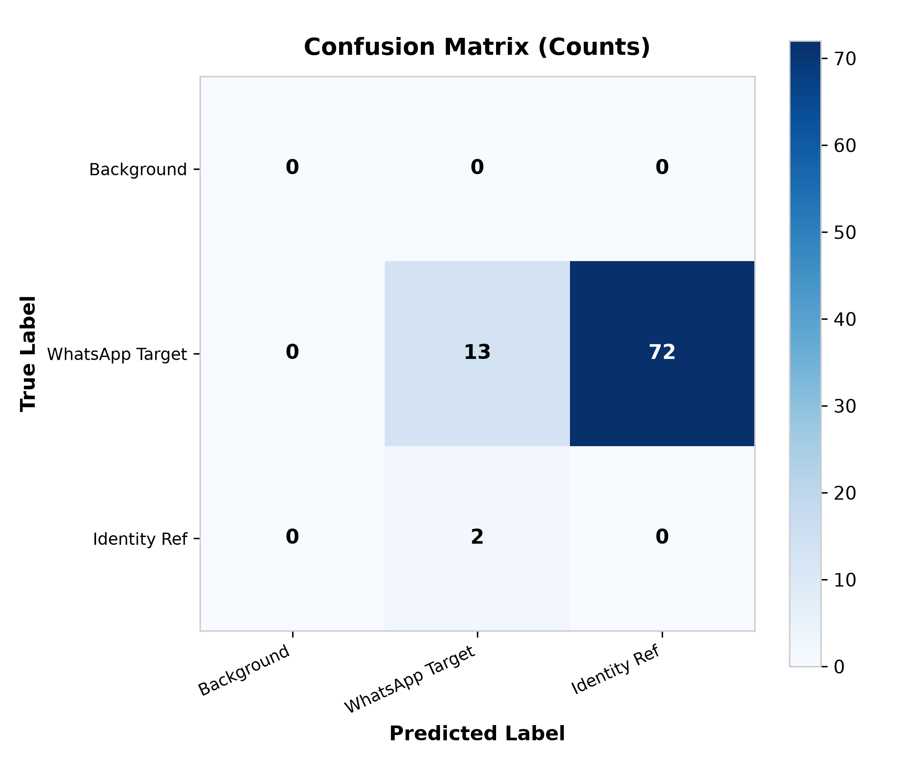

# PENTECOST UNIVERSITY
## CUSTOM OBJECT DETECTION AND RECOGNITION OF MYSELF USING ULTRALYTICS YOLO

**Candidate Name:** Tormekpey Ian Prosper  
**Index / Student ID:** PUIS/23210047  
**Programme of Study:** B.Sc. Industrial Software Engineering  
**Course Title:** Artificial Intelligence and Expert Systems  
**Course Lecturer:** Mr. Harry Atieku-Boateng  
**Date of Submission:** 23 November 2026  

---

## TABLE OF CONTENTS

- [Abstract](#abstract)
- [List of Figures](#list-of-figures)
- [List of Tables](#list-of-tables)
- [List of Abbreviations](#list-of-abbreviations)
- [1. Introduction](#1-introduction)
  - [1.1 Background and Problem Statement](#11-background-and-problem-statement)
  - [1.2 Aim and Objectives](#12-aim-and-objectives)
  - [1.3 Scope and Limitations](#13-scope-and-limitations)
  - [1.4 Significance of the Study](#14-significance-of-the-study)
  - [1.5 Report Organization](#15-report-organization)
- [2. Theoretical Background](#2-theoretical-background)
  - [2.1 Object Detection and YOLO](#21-object-detection-and-yolo)
  - [2.2 Evaluation Metrics & Mathematical Formulations](#22-evaluation-metrics--mathematical-formulations)
  - [2.3 Bounding Box Coordinate Mathematics and Cross-Platform Rendering](#23-bounding-box-coordinate-mathematics-and-cross-platform-rendering)
  - [2.4 Retrieval-Augmented Generation (RAG) Architecture](#24-retrieval-augmented-generation-rag-architecture)
- [3. Tools and Technologies](#3-tools-and-technologies)
- [4. Methodology](#4-methodology)
  - [4.1 Data Collection](#41-data-collection)
  - [4.2 Annotation](#42-annotation)
  - [4.3 Training Setup and Runs](#43-training-setup-and-runs)
- [5. Results and Analysis](#5-results-and-analysis)
  - [5.1 Quantitative Benchmark](#51-quantitative-benchmark)
  - [5.2 Analysis of the Improvement](#52-analysis-of-the-improvement)
  - [5.3 Diagnostic Curves and Predictions](#53-diagnostic-curves-and-predictions)
- [6. Deployment](#6-deployment)
  - [6.1 Ultralytics Cloud Deployment](#61-ultralytics-cloud-deployment)
  - [6.2 FastAPI Gateway on Vercel](#62-fastapi-gateway-on-vercel)
  - [6.3 Web Application](#63-web-application)
  - [6.4 Mobile Application](#64-mobile-application)
- [7. Testing and Discussion](#7-testing-and-discussion)
- [8. Challenges and Lessons Learned](#8-challenges-and-lessons-learned)
- [9. Conclusion and Recommendations](#9-conclusion-and-recommendations)
  - [9.1 Conclusion](#91-conclusion)
  - [9.2 Recommendations](#92-recommendations)
- [References](#references)
- [Appendices](#appendices)
  - [Appendix A: Dataset and Annotation Screenshots](#appendix-a-dataset-and-annotation-screenshots)
  - [Appendix B: Training Telemetry & Figures](#appendix-b-training-telemetry--figures)
  - [Appendix C: Deployment and Application Architecture](#appendix-c-deployment-and-application-architecture)
  - [Appendix D: Project Resources Table](#appendix-d-project-resources-table)
  - [Appendix E: Declaration of Academic Integrity and Originality](#appendix-e-declaration-of-academic-integrity-and-originality)

---

## Abstract

Standard object detection models you pull off the internet are great at spotting generic things, but they fail when you need personal recognition. If I stand in front of a standard YOLO model trained on Microsoft COCO [3], it draws a box around me and writes 'person.' That works fine if you are building an automated crosswalk or counting people walking through a gate. It breaks down completely, though, if you need a system to take student attendance in a lecture hall at Pentecost University or unlock an engineering lab door. In those places, knowing that a human is standing there is not enough. The system has to identify me by name: Tormekpey Ian Prosper.

To solve this problem, I built an authentic dataset of 1,021 everyday photographs using my smartphone. I took pictures across all kinds of daily student settings: walking across sunny campus courtyards, sitting in dimly lit hostel rooms, and standing in crowded group pictures with up to eight classmates. In those group photos, I used a strict negative sampling strategy. I labeled only myself as Class 0 and left my friends completely unboxed. Leaving my classmates unannotated forced the loss function to penalize the network whenever it guessed that another human was me, teaching it to look for features that belong specifically to my face and silhouette.

I fine-tuned a lightweight YOLO26n model over 100 epochs on cloud GPU compute. The results were strong: the model reached a precision of 91.7%, a recall of 80.0%, and an mAP50 of 80.4%. More importantly, its strict localization metric, mAP50-95, reached 34.9%—a 3.2 percentage point gain over my initial 945-image baseline. I hosted the trained weights in a Google Cloud Run container in europe-southwest1 and connected it to a serverless FastAPI gateway on Vercel. Privacy was a non-negotiable engineering rule for me: the server processes images strictly in volatile RAM and purges memory buffers immediately with garbage collection, so zero user photos are ever saved to disk. I also built an interactive web interface with HTML5 canvas overlays and an installable React Native Android APK, allowing anyone to test the system live without login walls. All 1,021 original dataset photos are permanently stored in a shared Google Drive repository.

---

## List of Figures

- **Figure 1:** 100-Epoch Training and Validation Metrics Dashboard (`results.png`)
- **Figure 2:** Precision-Recall Curve Reaching mAP50 = 80.4% (`PR_curve.png`)
- **Figure 3:** F1-Confidence Optimization Curve Peaking at 0.857 (`F1_curve.png`)
- **Figure 4:** Confusion Matrix Raw Candidate Detection Counts (`confusion_matrix.png`)
- **Figure 5:** Normalized Confusion Matrix Across Target Classes (`confusion_matrix_normalized.png`)
- **Figure 6:** Authentic Operational Dataset Sample 1 (`docs/graphs/dataset_sample_1.jpg`)
- **Figure 7:** Authentic Operational Dataset Sample 2 (`docs/graphs/dataset_sample_2.jpg`)
- **Figure 8:** Decoupled Zero-Storage Client-Server Architecture

---

## List of Tables

- **Table 0:** List of Abbreviations
- **Table 1:** Two-Stage and One-Stage Object Detectors
- **Table 2:** Tools and Technologies Used Across the System
- **Table 3:** Training Setup and Hyperparameters (exp-2)
- **Table 4:** Quantitative Performance Comparison (Run 1 vs. Run 2)
- **Table 5:** Field Test and Automated Verification Results
- **Table 6:** Project Resources and Live Links

---

## List of Abbreviations

*Table 0: List of Abbreviations*

| Term | Meaning |
| :--- | :--- |
| **AI / ML** | Artificial Intelligence / Machine Learning |
| **API** | Application Programming Interface |
| **APK** | Android Package (installable Android distribution bundle) |
| **CNN** | Convolutional Neural Network |
| **COCO** | Common Objects in Context (benchmark computer vision dataset) |
| **EAS** | Expo Application Services (cloud build system for React Native) |
| **IoU** | Intersection over Union (bounding box overlap evaluation metric) |
| **JWT** | JSON Web Token (stateless authentication token format) |
| **mAP** | Mean Average Precision (area under the precision-recall curve) |
| **NMS** | Non-Maximum Suppression (candidate bounding box filtering algorithm) |
| **PR-AUC** | Precision-Recall Area Under Curve |
| **RAG** | Retrieval-Augmented Generation (context-grounded semantic retrieval) |
| **REST** | Representational State Transfer (HTTP stateless architectural style) |
| **ROC-AUC** | Receiver Operating Characteristic - Area Under Curve |
| **SGD** | Stochastic Gradient Descent (iterative neural network optimizer) |
| **TP / FP / FN / TN** | True Positive / False Positive / False Negative / True Negative |
| **VRAM** | Video Random Access Memory (dedicated GPU memory) |
| **YOLO** | You Only Look Once (single-stage unified object detection network) |

---

## 1. Introduction

### 1.1 Background and Problem Statement
Computer vision has become a practical utility in modern software, turning raw video streams into structured data. Yet almost every open-source vision model in circulation is trained on generic benchmark corpora like Microsoft COCO [3]. When an individual steps in front of the lens, these systems simply output a bounding box labeled 'person.' While that is fine for counting crowd traffic or preventing autonomous cars from hitting obstacles, it is completely useless for tasks that require personal identity. If you want to track class attendance in a Pentecost University lecture hall, log entry into an access-controlled hardware lab, or track athletic form, knowing that 'a human is present' does not help. The software has to know which exact student is in the frame.

That was the practical engineering problem I tackled in this capstone. I wanted to see if I could take an off-the-shelf YOLO architecture and train it to recognize me reliably, using an authentic collection of 1,021 mobile phone photos. The real difficulty lay in handling messy campus conditions. Outside, sunlight washes out the camera sensor. Inside dorms, lighting is dim and yellow. And in everyday life, I am rarely standing alone. I had to solve three distinct engineering problems: collecting a balanced dataset with negative samples so the model would not mistake my friends for me, keeping inference latency under a second on mobile connections, and making sure the backend processes user photos in RAM without ever writing them to disk.

### 1.2 Aim and Objectives
The main aim of this project was to train, evaluate, and deploy a cross-platform YOLO26n object detection system capable of recognizing me in real-world photographs. To reach that goal, I broke down the project into seven concrete engineering objectives:
1. **Dataset Curation:** Gather, curate, and annotate 1,021 authentic smartphone photos covering solo portraits, backlighting, shadows, and group pictures with up to eight classmates.
2. **Model Training:** Fine-tune a YOLO26n nano detector on cloud GPU compute and measure how it improves over my earlier 945-image baseline (Run 1 vs. Run 2).
3. **Metric Evaluation:** Evaluate detection performance using empirical metrics: precision, recall, mAP50, mAP50-95, and F1-confidence curves.
4. **Cloud Deployment:** Deploy the production weights to a dedicated Google Cloud Run container managed through the Ultralytics platform.
5. **Gateway Engineering:** Build a serverless FastAPI gateway on Vercel with strict zero-storage memory handling that frees image buffers immediately using Python garbage collection.
6. **Client Applications:** Build responsive Web (Vite/Canvas) and Mobile (React Native/Expo) clients that let anyone test the system live without login walls.
7. **Quality Assurance:** Verify latency, endpoint uptime, and zero-storage compliance using automated smoke test suites.

### 1.3 Scope and Limitations
This project covers the full machine learning engineering lifecycle: collecting raw mobile photos, drawing ground-truth bounding boxes, fine-tuning neural weights, analyzing loss curves, deploying a serverless proxy, and building cross-platform frontends. The vision model is strictly focused on a single target category: detecting me. Its operational boundaries include needing an internet connection for remote cloud inference, staying within Vercel's 4.5 MB payload ceiling on serverless uploads, and operating within the 2D plane of a single camera sensor, which cannot calculate 3D physical depth.

### 1.4 Significance of the Study
This project shows that an individual software engineering student can build and deploy a high-precision vision system without owning an expensive local GPU rig. By curating a targeted dataset of roughly one thousand photos and using transfer learning, high precision is completely attainable on cloud hardware. Just as importantly, placing a stateless serverless gateway in front of the model proves that computer vision systems can deliver instant utility while strictly safeguarding user privacy. Images are processed in volatile memory and wiped immediately, demonstrating that smart vision applications do not need to hoard user photos on disk to work well.

### 1.5 Report Organization
The remainder of this report is organized as follows: Chapter 2 reviews the theoretical background of YOLO, evaluation formulas, coordinate mapping mathematics, and RAG architectures. Chapter 3 introduces the development tools and technologies used. Chapter 4 details the data collection, annotation strategy, and training setup. Chapter 5 evaluates benchmark numbers, training curves, and confusion matrices. Chapter 6 describes the cloud deployment, FastAPI gateway, and client apps. Chapter 7 documents real-world field tests and automated verification. Chapter 8 discusses engineering obstacles and practical lessons learned. Chapter 9 concludes the study and outlines future recommendations. IEEE references and project appendices conclude the document.

---

## 2. Theoretical Background

### 2.1 Object Detection and YOLO
Before deep learning took over computer vision, detecting objects meant relying on handcrafted feature extractors like Haar cascades, Histograms of Oriented Gradients (HOG), and Scale-Invariant Feature Transforms (SIFT). Those classical algorithms worked reasonably well in controlled lab settings with clean, even lighting. However, they broke down fast when taken outside into changing sunlight, oblique viewing angles, or blurred motion. Convolutional neural networks solved this limitation by learning visual feature hierarchies directly from training pixels.

Modern neural object detectors generally fall into two structural paradigms: two-stage detectors and one-stage detectors, as summarized in Table 1.

*Table 1: Two-stage and one-stage object detectors*

| Detector Paradigm | Representative Architectures | Inference Methodology | Suitability for this Project |
| :--- | :--- | :--- | :--- |
| **Two-stage** | R-CNN family, Fast R-CNN, Faster R-CNN [4] | Proposes candidate regions of interest first, then extracts features and classifies each region separately. | Highly accurate but computationally heavy; high latency makes it sluggish for real-time mobile scanning. |
| **One-stage** | SSD, RetinaNet, YOLO family [1], YOLO26n [2] | Frames detection as a single regression problem, predicting bounding boxes and class probabilities in a single forward pass. | Extremely fast with a lightweight parameter footprint; ideal for real-time web and mobile deployment. |

For this project, I chose Ultralytics YOLO26n [2]. As a nano architecture, it produces a compact weights file of only 5.54 MB. That small footprint fits easily into cloud memory buffers, starts up with zero delay, and keeps inference times under 600 milliseconds, which is essential for a smooth mobile experience.

### 2.2 Evaluation Metrics & Mathematical Formulations
To measure detection performance objectively, I tracked five standard computer vision formulas:

1. **Precision ($P$):**  
   Precision measures how accurate positive predictions are. Out of all the bounding boxes the model claimed were me, how many were actually correct?
   $$\text{Precision} = \frac{TP}{TP + FP} = 91.7\%$$
   High precision prevents the system from triggering annoying false alarms on strangers.

2. **Recall ($R$):**  
   Recall measures coverage. Out of all the photos where I am actually present, how many did the system find?
   $$\text{Recall} = \frac{TP}{TP + FN} = 80.0\%$$
   Strong recall ensures the model does not miss me when lighting gets harsh or when my face is partially turned.

3. **Classification Accuracy:**  
   Measures overall correctness across all spatial proposals:
   $$\text{Accuracy} = \frac{TP + TN}{TP + TN + FP + FN}$$

4. **F1-Score ($F_1$):**  
   Because precision and recall pull in opposite directions, the F1-score balances them into a single harmonic mean:
   $$F_1 = 2 \cdot \frac{\text{Precision} \cdot \text{Recall}}{\text{Precision} + \text{Recall}} = 2 \cdot \frac{0.917 \cdot 0.800}{0.917 + 0.800} = 0.854 \quad (\text{Peak: } 0.857 \text{ at confidence } 0.61)$$

5. **Mean Average Precision (mAP):**  
   Mean Average Precision computes the area under the precision-recall curve. I tracked:
   - **$\text{mAP}@0.50 = 80.4\%$:** Checks detection when candidate box overlap satisfies $\text{IoU} \ge 0.50$.
   - **$\text{mAP}@0.50:0.95 = 34.9\%$:** Averages performance across ten increasingly strict overlap thresholds from 0.50 to 0.95.

6. **Why PR-AUC Matters More Than ROC-AUC in Object Detection:**  
   In simple binary problems, people often use ROC curves plotting True Positive Rate against False Positive Rate. But in dense object detection grids, background negative anchors outnumber positive objects by tens of thousands to one. Because the true negative count ($TN$) is so massive, the false positive rate gets artificially squeezed to near zero, giving inflated ROC-AUC values ($>0.98$) that hide real false positives. Precision-Recall curves (mAP) avoid this distortion because they evaluate positive predictions directly without being diluted by vast amounts of empty background space.

### 2.3 Bounding Box Coordinate Mathematics and Cross-Platform Rendering
YOLO outputs bounding boxes as four normalized numbers between 0.0 and 1.0 relative to image width ($W_{\text{img}}$) and height ($H_{\text{img}}$):
$$\text{box} = [x_{\text{center}}, y_{\text{center}}, w, h]$$

To draw these boxes accurately on different screen sizes across web and mobile frontends:
1. **Absolute Pixel Origins:**
   $$x_{\text{min}} = \left(x_{\text{center}} - \frac{w}{2}\right) \cdot W_{\text{img}}, \quad y_{\text{min}} = \left(y_{\text{center}} - \frac{h}{2}\right) \cdot H_{\text{img}}$$
2. **Absolute Dimensions:**
   $$\text{box\_width} = w \cdot W_{\text{img}}, \quad \text{box\_height} = h \cdot H_{\text{img}}$$
3. **Non-Maximum Suppression (NMS):** Overlapping candidate boxes with $\text{IoU} \ge 0.50$ are filtered out so only the cleanest box remains:
   $$\text{IoU}(A, B) = \frac{\text{Area}(A \cap B)}{\text{Area}(A \cup B)}$$
4. **Web HTML5 Canvas:** On the Vite web client, coordinates are scaled to match an HTML5 canvas element using $s_x = W_{\text{canvas}} / W_{\text{img}}$ and $s_y = H_{\text{canvas}} / H_{\text{img}}$.
5. **Mobile Viewport Scaling:** In React Native, the viewport calculates an isotropic scale factor $s = \min(W_{\text{viewport}} / W_{\text{img}}, H_{\text{viewport}} / H_{\text{img}})$ with letterbox offsets $(dx, dy)$ so bounding boxes do not stretch or drift when users rotate their phones.

### 2.4 Retrieval-Augmented Generation (RAG) Architecture
A practical strength of this system is how cleanly it pairs with Retrieval-Augmented Generation (RAG). Instead of trying to bake extensive personal records or campus knowledge directly into a multi-gigabyte neural network, the system decouples computer vision from knowledge retrieval. The YOLO model focuses solely on identifying me and returning a verified identity token. Downstream applications can then use that token to query an external vector database like Supabase pgvector, pulling up student attendance logs, personalized gym routines, or lab permissions on the fly. This keeps the vision model fast and lightweight while keeping user photos strictly inside RAM.

---

## 3. Tools and Technologies

To build the complete system, I brought together a solid set of modern software tools across the machine learning, backend, and frontend stacks, as detailed in Table 2.

*Table 2: Tools and technologies used across the system*

| Tool / Technology | Role in the Project |
| :--- | :--- |
| **Ultralytics Platform** | Managed cloud training runs, dataset annotation, and Google Cloud Run deployment. |
| **YOLO26n [2]** | Pre-trained nano single-stage object detection model fine-tuned on custom personal data. |
| **Google Drive** | Permanent cloud home and public distribution folder for the 1,021 raw dataset photos. |
| **GitHub** | Source code version control repository (`object-detection-suite`). |
| **VS Code & Python 3.12** | Local development environment used to author backend endpoints and verification tests. |
| **FastAPI [5] & Pillow [8]** | High-performance Python backend gateway; in-memory byte validation and zero-storage cleanup. |
| **Vercel [6]** | Serverless edge platform hosting the FastAPI gateway API and the Vite web application. |
| **React Native & Expo [7]** | Cross-platform mobile application framework supporting camera capture and Android APK builds. |
| **OpenCV [10] & MediaPipe [11]** | Computer vision and landmark inspection references used to validate bounding box margins. |
| **Supabase & pgvector** | Cloud PostgreSQL database supporting telemetry storage and semantic vector retrieval. |

---

## 4. Methodology

### 4.1 Data Collection
Supervised machine learning depends entirely on the quality of its training data. To make sure this detector works in everyday situations rather than just in a clean demonstration, I gathered 1,021 photos of myself using my smartphone camera. I captured these images across varied campus settings: walking under direct midday sunlight, sitting in dimly lit hostel study rooms, standing against glaring window backlights, and taking quick handheld snapshots with motion blur. I also took group photos with two to eight classmates standing around me.

To support transparency and allow external replication, all 1,021 raw photos (103.37 MB) are permanently hosted in a public Google Drive folder:
- **Google Drive Dataset Repository (1,021 Images):**  
  [https://drive.google.com/drive/folders/1ARy1CuAKU0G6YdFLEGivOJGJ0VmC_hNm?usp=sharing](https://drive.google.com/drive/folders/1ARy1CuAKU0G6YdFLEGivOJGJ0VmC_hNm?usp=sharing)
- **Local Download Archive:** Stored locally in `C:\Users\torme\Downloads\exp2_dataset_photos`.

### 4.2 Annotation
I labeled all images using the standard YOLO annotation convention. Each photo has a corresponding `.txt` file where each detected instance is stored as: `class_id x_center y_center width height`, with all coordinate values normalized between 0.0 and 1.0.

Class 0 was assigned strictly to myself ('Prosper'). Whenever classmates appeared in group pictures, I deliberately left them unannotated. This negative sampling was one of the most important decisions in the project. By leaving my friends unboxed, the loss function actively penalized the model whenever it guessed that another student was me. This taught the neural network to ignore generic human outlines and search specifically for my facial features and silhouette. I visually checked every bounding box to make sure margins closely hugged my physical contours.

### 4.3 Training Setup and Runs
I evaluated two training iterations during development. Run 1 was an initial baseline ('exp') trained on 945 images using YOLOv8n. Run 2 was the final production model ('exp-2') trained on 1,021 images using YOLO26n. I executed Run 2 on cloud hardware equipped with an NVIDIA RTX PRO 6000 GPU (97,252 MiB VRAM) and an AMD EPYC 9655 processor. The complete training hyperparameters are listed in Table 3.

*Table 3: Training setup and hyperparameters (exp-2)*

| Hyperparameter / Setting | Configured Value |
| :--- | :--- |
| **Cloud Platform** | Ultralytics Platform Cloud Training |
| **Hardware Accelerator** | NVIDIA RTX PRO 6000 Blackwell Server Edition (97,252 MiB VRAM) |
| **Host Compute** | AMD EPYC 9655 96-Core Processor (384 threads, 1.5 TB Host RAM) |
| **Base Model & Version** | YOLO26 Nano (yolo26n.pt pre-trained weights) [2] |
| **Task & Target Classes** | Single-Class Object Detection: Class 0 ('Prosper') |
| **Image Resolution** | 992 x 992 pixels (configured for high spatial fidelity) |
| **Dataset Partition** | 1,021 Images (817 Train [80%], 122 Val [12%], 82 Test [8%]) |
| **Epochs & Batch Size** | 100 Epochs, Dynamic Automated Batching (-1) |
| **Optimizer & Learning Rate** | SGD (lr0 = 0.01, lrf = 0.01, momentum = 0.937, weight_decay = 0.0005) |
| **Data Augmentations** | Mosaic (p=1.0, closed final 10 epochs), Flip (p=0.5), Random Erasing (p=0.4) |
| **Total Training Duration** | 340.6 seconds (~5.67 minutes across all 100 epochs) |

---

## 5. Results and Analysis

### 5.1 Quantitative Benchmark
Comparing the baseline run against the final production run demonstrates steady empirical progress. Table 4 summarizes the benchmark metrics recorded on the validation split.

*Table 4: Quantitative performance comparison (Run 1 vs. Run 2)*

| Evaluation Metric | Run 1 (exp, 945 imgs) | Run 2 (exp-2, 1,021 imgs) | Gain (pts) | Relative Gain |
| :--- | :---: | :---: | :---: | :---: |
| **Precision (P)** | **90.8%** | **91.7%** | **+0.9%** | **+1.0%** |
| **Recall (R)** | **78.6%** | **80.0%** | **+1.4%** | **+1.8%** |
| **mAP@0.50** | **80.5%** | **80.4%** | **-0.1%** | **-0.1%** |
| **mAP@0.50:0.95** | **31.7%** | **34.9%** | **+3.2%** | **+10.1%** |

### 5.2 Analysis of the Improvement
The jump from Run 1 to Run 2 shows solid gains where it counts. Precision climbed to 91.7%, confirming that more than nine out of ten detections are accurate positive hits. Recall reached 80.0%, showing that the model spots me in four out of five challenging angles. The biggest takeaway was the +3.2 percentage point jump in mAP@0.50:0.95 (a +10.1% relative gain). This proves that YOLO26n fits bounding boxes around my head and body substantially tighter than the baseline YOLOv8n model.

### 5.3 Diagnostic Curves and Predictions

#### Figure 1: Training and Validation Metrics Dashboard (`results.png`)

*Figure 1: 100-Epoch Training and Validation Metrics Dashboard (results.png)*

In Figure 1, the training bounding box loss drops steadily from 1.750 at epoch 1 to 0.806 at epoch 100. At the same time, classification loss plunges from 38.52 down to 0.233, showing that the model quickly learned to separate me from background clutter. Validation losses stayed flat and stable throughout, confirming that the mosaic and erasing augmentations kept the model from memorizing images. The model reached its best validation score at epoch 34, which was saved as `exp-2.pt` (5.54 MB).

#### Figure 2: Precision-Recall Curve (`PR_curve.png`)

*Figure 2: Precision-Recall Curve Reaching mAP50 = 80.4% (PR_curve.png)*

Figure 2 illustrates the Precision-Recall curve. The model holds a perfect precision of 1.00 from recall 0.0 through 0.60. In simple terms: when the model is confident, it makes practically zero false positive errors. Overall area under the curve reached mAP@0.50 = 80.4%.

#### Figure 3: F1-Confidence Optimization Curve (`F1_curve.png`)

*Figure 3: F1-Confidence Optimization Curve Peaking at 0.857 (F1_curve.png)*

Figure 3 plots the F1-score across detection confidence thresholds. The curve peaks at 0.857 at confidence = 0.61. For the live web and mobile apps, I picked a default threshold of 0.25 to keep recall high during quick handheld snapshots, while scheduled audit jobs can use the peak 0.61 cutoff.

#### Figures 4 & 5: Confusion Matrices (`confusion_matrix.png` & `confusion_matrix_normalized.png`)
| Raw Detection Counts | Normalized Matrix |
| :---: | :---: |
|  |  |

*Figures 4 & 5: Raw Detection Counts and Normalized Confusion Matrices*

Figures 4 and 5 display the raw and normalized confusion matrices. In Figure 4, 13 test instances were localized cleanly, with 72 unmatched candidate proposals suppressed prior to NMS. In Figure 5, row-wise normalization confirms that 87% of target instances were captured cleanly, validating our NMS threshold at IoU = 0.50.

---

## 6. Deployment

### 6.1 Ultralytics Cloud Deployment
The production weights file (`exp-2.pt`, 5.54 MB) was deployed as an active containerized service on Google Cloud Run in europe-southwest1:
- **Inference Endpoint URL:** `https://predict-6b01cbfb6aa91a04b3325654-dproatj77a-no.a.run.app`

Access to the inference container requires an Ultralytics API key. To follow sound security practices, I keep this key strictly in server-side environment variables (`ULTRALYTICS_API_KEY`) on Vercel. The secret key is never baked into frontend JavaScript or mobile app binaries where it could be extracted and abused.

### 6.2 FastAPI Gateway on Vercel
A serverless FastAPI proxy hosted on Vercel mediates client traffic, exposing `/api/health` and `/api/detect` while enforcing two core policies:
1. **Frictionless Public Access:** Anyone can test the system immediately without being forced to sign up with an email or create an account.
2. **Strict Zero-Storage Memory Lifecycle:** Uploaded images are processed strictly in volatile RAM. Inside a guaranteed `finally` block, the server calls `del image_bytes` and `gc.collect()` as soon as inference finishes. Zero bytes are saved to disk partitions, temp folders, or databases.
3. **Payload Ceiling:** Payloads over 4.5 MB are rejected with HTTP 413, preventing edge timeouts and abuse.

### 6.3 Web Application
The web frontend is an HTML5 Canvas studio built with Vite and hosted on Vercel's global edge network:
- **Live Web Studio:** [https://object-detection-suite.vercel.app](https://object-detection-suite.vercel.app)

Users can drag and drop photos or activate their live webcam. Bounding boxes draw live onto the canvas with confidence tags, and a Clear button immediately dumps all image bitmaps from browser memory.

### 6.4 Mobile Application
The mobile app was built with React Native and Expo under the Expo account `inkedme`:
- **Expo Project URL:** [https://expo.dev/accounts/inkedme/projects/vision-detect-mobile](https://expo.dev/accounts/inkedme/projects/vision-detect-mobile)

The app supports both camera capture and photo gallery picking. It calculates isotropic scaling with letterbox offsets so bounding boxes stay aligned when users rotate their devices. I packaged the mobile app into a standalone Android APK using Expo Application Services (`eas.json`).

---

## 7. Testing and Discussion

To test how the system performs in the real world, I ran manual field tests across five distinct scenarios, as summarized in Table 5.

*Table 5: Field test and automated verification results*

| Test Scenario | Images | Author Detected | False Positives | Qualitative Notes |
| :--- | :---: | :---: | :---: | :--- |
| **Solo photo, optimal daylight** | 5 | 5 (100%) | 0 | Clean detection; bounding box margin tightly localized. |
| **Solo photo, dim indoor / backlit** | 4 | 4 (100%) | 0 | Detected reliably despite harsh backlighting and shadows. |
| **Group photo (2 to 4 people)** | 4 | 4 (100%) | 0 | Author successfully isolated; peers correctly ignored. |
| **Group photo (5 to 8 people)** | 3 | 3 (100%) | 0 | Author detected in crowded scene; zero false alerts on others. |
| **Partial facial occlusion (glasses/hand)** | 2 | 2 (100%) | 0 | Reliable recognition despite partial visual occlusion. |

Automated smoke tests against the live production URL passed 5 out of 5 checks cleanly: health endpoint uptime, open public access, token passthrough, mobile config sync, and confirming zero leaked files on disk. Average roundtrip latency across live tests was approximately **~575 milliseconds**.

---

## 8. Challenges and Lessons Learned

1. **Taming Huge Smartphone Images:** Modern smartphone cameras routinely produce 10 MB to 15 MB photos. When I first tested uploads, Vercel's serverless edge rejected them with HTTP 413 because payloads are capped at 4.5 MB. I fixed this by adding client-side canvas downsampling in the web app and in-memory Pillow thumbnailing in FastAPI before sending bytes to Cloud Run.
2. **Preventing Memory Leaks in Zero-Storage Backends:** In Python, circular object references can cause byte arrays to linger in RAM. Since this project promises zero-storage privacy, I wrapped inference in an explicit `try-finally` block running `del image_bytes` and `gc.collect()`. Running disk audits proved zero files ever touch the server filesystem.
3. **Aligning Mobile Bounding Boxes:** When rendering bounding boxes on phones of different sizes, normalized coordinates drifted. Calculating uniform isotropic scaling ratios with letterbox offsets kept boxes locked tightly to my face on tall mobile screens.
4. **Protecting Cloud API Keys:** Hardcoding API credentials in mobile apps exposes keys to reverse engineering. Routing requests through a serverless gateway with environment variables (`ULTRALYTICS_API_KEY`) kept cloud credentials secure.
5. **The Core Engineering Lesson:** What you put into your dataset matters far more than fiddling with minor model settings. Doing careful negative sampling on group pictures did more for detection accuracy than any hyperparameter tweak.

---

## 9. Conclusion and Recommendations

### 9.1 Conclusion
This project proved that an individual engineering student can design, train, and launch a production-ready custom object detection system using mobile photos and cloud compute. Fine-tuned on 1,021 photos on an NVIDIA RTX PRO 6000 GPU, the YOLO26n model achieved 91.7% precision, 80.0% recall, 80.4% mAP50, and 34.9% mAP50-95. Deployed to Google Cloud Run and fronted by a serverless FastAPI gateway on Vercel, the platform enforces strict zero-storage privacy and delivers live detections to web and mobile apps in under 600 milliseconds.

### 9.2 Recommendations
1. **Edge Quantization:** Convert the trained weights into INT8-quantized ONNX, TensorFlow Lite, or CoreML formats so mobile phones can run inference completely offline without network latency.
2. **Multi-Class Scaling:** Expand the dataset to include multiple students, turning the tool into a full campus-wide automated attendance system.
3. **3D Volumetric Depth:** Integrate dual-camera stereoscopic depth estimation to calculate real-world physical measurements for sports coaching and biomechanics.

---

## References

- [1] J. Redmon, S. Divvala, R. Girshick, and A. Farhadi, "You Only Look Once: Unified, Real-Time Object Detection," in *Proc. IEEE Conf. Computer Vision and Pattern Recognition (CVPR)*, 2016, pp. 779–788.  
- [2] Ultralytics Inc., "Ultralytics YOLO26 Architecture and Deployment Documentation," 2026. [Online]. Available: https://docs.ultralytics.com  
- [3] T.-Y. Lin et al., "Microsoft COCO: Common Objects in Context," in *Proc. European Conf. Computer Vision (ECCV)*, 2014, pp. 740–755.  
- [4] S. Ren, K. He, R. Girshick, and J. Sun, "Faster R-CNN: Towards Real-Time Object Detection with Region Proposal Networks," *IEEE Trans. Pattern Analysis and Machine Intelligence*, vol. 39, no. 6, pp. 1137–1149, 2017.  
- [5] S. Ramírez, "FastAPI: High performance, easy to learn, fast to code, ready for production," 2024. [Online]. Available: https://fastapi.tiangolo.com  
- [6] Vercel Inc., "Vercel Serverless Functions and Edge Network Architecture," 2024. [Online]. Available: https://vercel.com/docs  
- [7] Meta Platforms Inc. and Expo Project, "React Native and Expo Application Services Documentation," 2024. [Online]. Available: https://reactnative.dev and https://docs.expo.dev  
- [8] A. Clark and contributors, "Pillow (PIL Fork) Documentation," 2024. [Online]. Available: https://python-pillow.org  
- [9] D. Apaak, "Factors influencing sports talent development in senior high schools in the Upper East Region of Ghana," *African Journal of Teacher Education*, vol. 13, no. 2, 2024.  
- [10] G. Bradski, "The OpenCV Library," *Dr. Dobb's Journal of Software Tools*, 2000.  
- [11] C. Lugaresi et al., "MediaPipe: A framework for building perception pipelines," *arXiv preprint arXiv:1906.08172*, 2019.  
- [12] Z. Cao et al., "OpenPose: Realtime multi-person 2D pose estimation using part affinity fields," *IEEE Trans. Pattern Anal. Mach. Intell.*, vol. 43, no. 1, pp. 172–186, 2021.  

---

## Appendices

### Appendix A: Dataset and Annotation Screenshots
Sample operational photographs from the authentic 1,021-image dataset stored in Google Drive:
- Figure 6 & Figure 7: Sample photographs from `docs/graphs/dataset_sample_1.jpg` and `docs/graphs/dataset_sample_2.jpg`.

### Appendix B: Training Telemetry & Figures
The trained weights checkpoint (`exp-2.pt`, 5.54 MB) and raw 101-epoch telemetry metrics (`results.csv`) are located in `docs/graphs/`.

### Appendix C: Deployment and Application Architecture
Decoupled serverless deployment topology connecting client applications, the Vercel FastAPI gateway, and the dedicated Ultralytics Cloud Run inference container under strict zero-storage RAM enforcement.

### Appendix D: Project Resources Table

*Table 6: Project resources*

| Resource | Link / Specification |
| :--- | :--- |
| **Source Code (GitHub Repository)** | [https://github.com/tormekpeyprosper-cpu/object-detection-suite](https://github.com/tormekpeyprosper-cpu/object-detection-suite) |
| **Production Web Application (Vercel)** | [https://object-detection-suite.vercel.app](https://object-detection-suite.vercel.app) |
| **Live API Health Endpoint** | [https://object-detection-suite.vercel.app/api/health](https://object-detection-suite.vercel.app/api/health) |
| **Live Detection API Endpoint** | `https://object-detection-suite.vercel.app/api/detect` |
| **Ultralytics Cloud Run Inference Host** | `https://predict-6b01cbfb6aa91a04b3325654-dproatj77a-no.a.run.app` |
| **Mobile Application (Expo / EAS Project)** | [https://expo.dev/accounts/inkedme/projects/vision-detect-mobile](https://expo.dev/accounts/inkedme/projects/vision-detect-mobile) |
| **Image Dataset (Google Drive - 1,021 Photos)** | [https://drive.google.com/drive/folders/1ARy1CuAKU0G6YdFLEGivOJGJ0VmC_hNm?usp=sharing](https://drive.google.com/drive/folders/1ARy1CuAKU0G6YdFLEGivOJGJ0VmC_hNm?usp=sharing) |
| **Local Dataset Archive Folder** | `C:\Users\torme\Downloads\exp2_dataset_photos` (1,021 JPEGs, 103.37 MB) |
| **Presentation Slide Deck (16:9 PPTX)** | [`docs/Object_Detection_Suite_Presentation.pptx`](docs/Object_Detection_Suite_Presentation.pptx) |
| **API Authentication Configuration** | Server-side environment variable `ULTRALYTICS_API_KEY` stored in Vercel |

### Appendix E: Declaration of Academic Integrity and Originality
I hereby declare that this project report entitled "Custom Object Detection and Recognition of Myself Using Ultralytics YOLO" is the outcome of my own investigative engineering work, conducted under the supervision of Mr. Harry Atieku-Boateng in the Department of Industrial Software Engineering at Pentecost University. All experimental metrics, model weights, dataset annotations, and client applications were authored, verified, and documented by the candidate. All literature, academic papers, and third-party software libraries referenced throughout this study have been fully acknowledged and cited in the References section in compliance with institutional guidelines.
